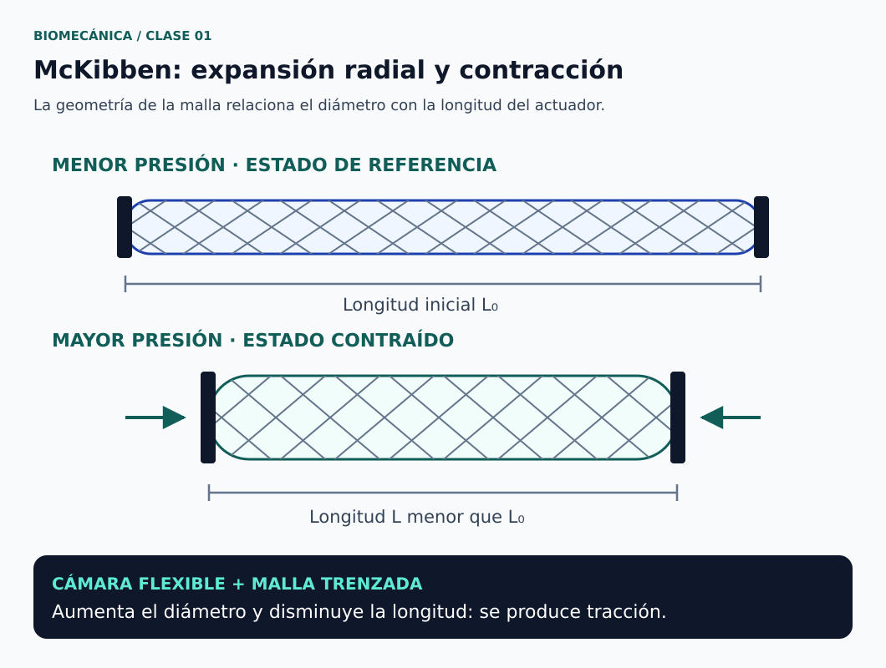
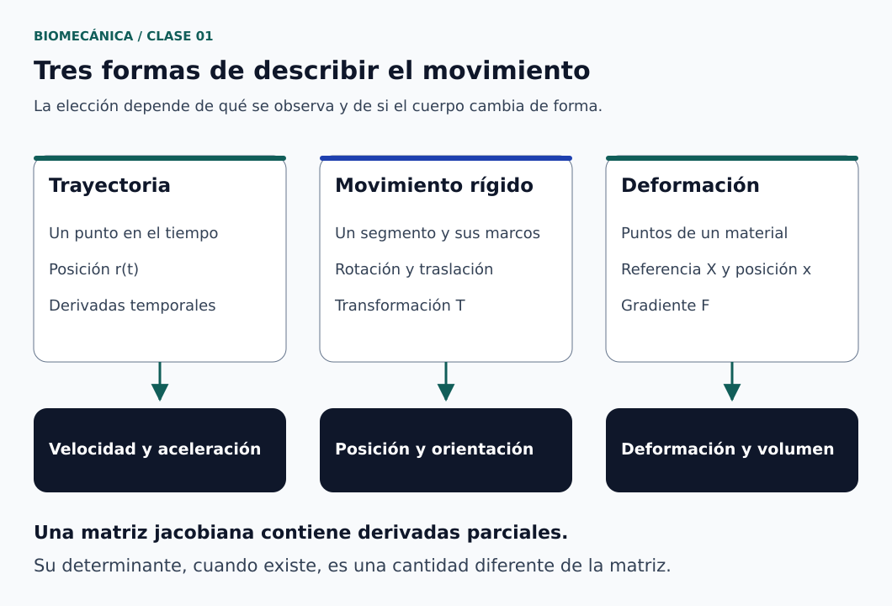

# Clase 01 · Movimiento, medio continuo y dispositivos de rehabilitación

**Asignatura:** Biomecánica  
**Docente:** David Cortez Saravia  
**Fecha de referencia:** 27 de octubre de 2026  
**Modalidad:** virtual

## El punto de partida

Estudiar el movimiento humano requiere algo más que observar cómo cambia una posición. Necesitamos elegir un modelo, establecer referencias y reconocer si estamos siguiendo un punto, describiendo un segmento rígido o analizando un material que se deforma.

La sesión presentó el enfoque de Biomecánica para Biomedicina, las herramientas de diseño y análisis que se utilizarán y ejemplos de dispositivos de rehabilitación. También introdujo el medio continuo, las transformaciones y las derivadas como bases para estudiar el movimiento.

## Propósito de la sesión

Relacionar física, matemáticas y diseño con problemas biomédicos, y establecer las primeras diferencias entre movimiento, deformación y actuación de un dispositivo.

## Una asignatura entre el cuerpo y la ingeniería

El curso abordará propiedades mecánicas, trayectorias, sistema musculoesquelético y aplicaciones de la mecánica de fluidos. Estos temas permiten formular preguntas de ingeniería:

- ¿Qué movimiento queremos observar o asistir?
- ¿Qué parte del sistema podemos representar como rígida?
- ¿Qué tejidos o componentes cambian de forma?
- ¿Qué variables debemos medir para comprobar el modelo?

Los detalles de evaluación, las actividades y la organización de las sesiones se consultan en AVAC.

## Dispositivos de rehabilitación y robótica blanda

Durante la clase se comentaron dispositivos para asistir el movimiento de los dedos mediante motores y transmisiones por cables, así como soluciones neumáticas basadas en cámaras deformables.

Ambas alternativas requieren considerar la generación y transmisión de fuerza, la alimentación, los sensores y el control. La comparación depende del sistema completo y de la tarea: no basta con contar los motores o sustituirlos por aire para concluir que una solución consume menos o se controla más fácilmente.

### Cómo funciona un McKibben contráctil

El McKibben convencional combina una cámara interna flexible, una malla trenzada exterior y terminales de conexión. Al presurizarse, la cámara tiende a expandirse radialmente y la geometría de la malla transforma esa expansión en acortamiento axial y fuerza de tracción. Es un principio diferente al de una cámara que se curva para flexionar un dedo. [1]

*Figura 1. Expansión radial y contracción axial en un McKibben convencional. [Créditos y fuente](figuras/CREDITOS.md) · [Descripción en texto](figuras/DESCRIPCIONES.md#figura-1).*

Las ilustraciones ayudan a reconocer el principio de actuación. La selección para una órtesis exige después comprobar fuerza, desplazamiento, interacción con la persona y condiciones de operación.

## Medio continuo: una elección de escala

El modelo de medio continuo representa propiedades mediante campos definidos en el espacio y el tiempo, sin resolver individualmente cada átomo. Un punto material identifica una porción idealizada de materia; no significa que el cuerpo se componga físicamente de infinitas partículas discretas.

Esta aproximación debe ser adecuada para la escala y el fenómeno estudiados. El movimiento relaciona una configuración de referencia con una configuración actual. [2]

## Tres descripciones que conviene distinguir

*Figura 2. Elegir el modelo antes de calcular. [Créditos](figuras/CREDITOS.md) · [Descripción en texto](figuras/DESCRIPCIONES.md#figura-2).*

### Trayectoria de un punto

Si conocemos la posición de un punto en función del tiempo, su velocidad y aceleración se obtienen mediante derivadas temporales:

$$
\mathbf{r}(t)=
\begin{bmatrix}
x(t)\\y(t)\\z(t)
\end{bmatrix},
\qquad
\mathbf{v}(t)=\frac{d\mathbf{r}}{dt},
\qquad
\mathbf{a}(t)=\frac{d^2\mathbf{r}}{dt^2}
$$

Con posición en metros y tiempo en segundos, la velocidad se expresa en m/s y la aceleración en m/s². Conocer tres funciones de posición permite derivarlas; no produce por sí solo una matriz espacial de deformación. [2]

### Movimiento rígido: rotación y traslación

Con vectores columna, la posición de un punto puede cambiarse entre dos sistemas de referencia mediante: [3]

$$
\begin{bmatrix}
\mathbf{p}_a\\1
\end{bmatrix}
=
\mathbf{T}_{ab}
\begin{bmatrix}
\mathbf{p}_b\\1
\end{bmatrix},
\qquad
\mathbf{T}_{ab}=
\begin{bmatrix}
\mathbf{R}_{ab}&\mathbf{d}_{ab}\\
\mathbf{0}^{T}&1
\end{bmatrix}
$$

$\mathbf{p}_b$ y $\mathbf{p}_a$ son las coordenadas del mismo punto en los marcos $b$ y $a$. $\mathbf{R}_{ab}$ es una rotación de 3 × 3 y $\mathbf{d}_{ab}$ expresa, en el marco $a$, la posición del origen de $b$.

Una rotación cumple $\mathbf{R}^{T}\mathbf{R}=\mathbf{I}$ y $\det\mathbf{R}=1$. Una escala que cambia longitudes no pertenece a una transformación rígida. El orden se establece con marcos y convenciones; para esta notación:

$$
\mathbf{T}_{ac}=\mathbf{T}_{ab}\mathbf{T}_{bc}
$$

### Deformación de un material

Para un continuo, el movimiento se escribe $\mathbf{x}=\boldsymbol{\chi}(\mathbf{X},t)$: $\mathbf{X}$ identifica la posición de referencia del punto material y $\mathbf{x}$ su posición actual. El gradiente de deformación es: [4]

$$
\mathbf{F}=\frac{\partial\boldsymbol{\chi}}{\partial\mathbf{X}},
\qquad
F_{ij}=\frac{\partial x_i}{\partial X_j}
$$

Se consideran las derivadas de cada coordenada actual respecto a todas las coordenadas de referencia. Su determinante es un escalar distinto de la matriz:

$$
J_V=\det\mathbf{F},
\qquad
dv=J_V\,dV
$$

$dV$ y $dv$ son volúmenes diferenciales de referencia y actuales. Para una deformación suave físicamente admisible se exige $J_V>0$. Un valor de 1 indica conservación local de volumen; uno mayor que 1, aumento local. Aquí $\mathbf{F}$ y $J_V$ son adimensionales. [4]

## La matriz jacobiana no es su determinante

Para una posición $\mathbf{p}=\mathbf{f}(\mathbf{q})$, la jacobiana de posición contiene derivadas respecto a las variables de configuración $q_j$: [5]

$$
(\mathbf{J}_q)_{ij}=\frac{\partial p_i}{\partial q_j},
\qquad
\dot{\mathbf{p}}=\mathbf{J}_q(\mathbf{q})\,\dot{\mathbf{q}}
$$

Se supone que $\mathbf{f}$ es diferenciable y no depende explícitamente del tiempo. Si depende también de $t$, la regla de la cadena añade $\partial\mathbf{f}/\partial t$.

| Herramienta | Qué relaciona |
| --- | --- |
| Derivada temporal de la posición | Posición, velocidad y aceleración de un punto |
| Jacobiana de posición $\mathbf{J}_q$ | Variaciones de coordenadas de configuración y de posición |
| Gradiente de deformación $\mathbf{F}$ | Separaciones materiales locales antes y después del movimiento |
| Determinante $J_V$ | Razón local de volúmenes |

La jacobiana puede ser rectangular, por lo que no siempre tiene determinante. Sus unidades dependen de las variables elegidas: si una coordenada $q_j$ es angular, una columna puede tener unidades de m/rad. El símbolo y las variables deben definirse en cada problema. [5]

## Ejercicio complementario · Movimiento y cambio de volumen

El siguiente ejemplo amplía el contenido con un campo de movimiento elegido para practicar; no reproduce las ecuaciones pendientes de la sesión.

Consideremos:

$$
\boldsymbol{\chi}(X,Y,Z,t)=
\begin{bmatrix}
(1+\alpha t)X\\
Y\\
Z
\end{bmatrix}
$$

| Dato didáctico | Valor |
| --- | --- |
| Tasa del modelo, $\alpha$ | 0.10 s⁻¹ |
| Instante de estudio, $t$ | 2.0 s |
| Punto de referencia, $\mathbf{X}$ | (0.200, 0, 0) m |

**Supuestos:** movimiento suave, extensión homogénea en la dirección $X$, dimensiones transversales constantes y $1+\alpha t>0$. No se adopta una ley de material ni se calculan esfuerzos.

### 1. Posición y desplazamiento

El factor de extensión es $1+\alpha t=1.20$. Por tanto:

$$
\mathbf{x}=
\begin{bmatrix}
0.240\\0\\0
\end{bmatrix}\mathrm{m},
\qquad
\mathbf{u}=\mathbf{x}-\mathbf{X}
=
\begin{bmatrix}
0.040\\0\\0
\end{bmatrix}\mathrm{m}
$$

### 2. Velocidad y aceleración material

Derivamos respecto al tiempo manteniendo fijo el punto de referencia:

$$
\mathbf{v}(\mathbf{X},t)=
\frac{\partial\boldsymbol{\chi}}{\partial t}
=
\begin{bmatrix}
\alpha X\\0\\0
\end{bmatrix}
=
\begin{bmatrix}
0.020\\0\\0
\end{bmatrix}\mathrm{m/s},
\qquad
\mathbf{a}=\mathbf{0}
$$

La velocidad de cada punto permanece constante en el tiempo, aunque cambia de un punto material a otro.

### 3. Gradiente y razón de volúmenes

$$
\mathbf{F}=
\begin{bmatrix}
1+\alpha t&0&0\\
0&1&0\\
0&0&1
\end{bmatrix},
\qquad
J_V=1+\alpha t=1.20
$$

**Interpretación.** El modelo aumenta un 20 % la longitud en una dirección y conserva las dimensiones transversales; su volumen también aumenta un 20 %. No es un movimiento rígido ni un modelo incompresible. El resultado no debe trasladarse a un tejido sin comprobar sus propiedades y las condiciones del problema.

### Para practicar

Si $J_V=1$ es una condición del modelo, ¿podemos estirar en una dirección y mantener sin cambios las otras dos? En una deformación de extensión sin cortante, los factores de extensión deben satisfacer:

$$
\lambda_1\lambda_2\lambda_3=1
$$

Por ello, una extensión longitudinal exige cambios transversales para conservar volumen.

### Recordatorio de derivación

Para una función exponencial:

$$
f(t)=A e^{kt}
\quad\Longrightarrow\quad
\frac{df}{dt}=Ak e^{kt}
$$

$A$ tiene las unidades de $f$ y el producto $kt$ debe ser adimensional. Si $t$ se expresa en segundos, $k$ tiene unidades de s⁻¹. Este detalle evita escribir un exponente con unidades físicas.

## Fluidos: por qué importa la pared del conducto

La pregunta sobre una velocidad mayor en el centro de un tubo se estudia con un modelo de flujo viscoso. Para flujo estacionario, laminar y plenamente desarrollado de un fluido newtoniano e incompresible, en un tubo recto, circular y rígido, con pared fija y condición de no deslizamiento, la velocidad axial es cero en la pared y máxima en el eje. La ley de Poiseuille relaciona caudal y presión: [6]

$$
Q=\frac{\pi R^4\Delta p}{8\mu L}
$$

| Símbolo | Magnitud | Unidad SI |
| --- | --- | --- |
| $Q$ | Caudal volumétrico | m³/s |
| $R$ | Radio interior del tubo | m |
| $\Delta p$ | Presión de entrada menos presión de salida | Pa |
| $\mu$ | Viscosidad dinámica | Pa·s |
| $L$ | Longitud del tramo | m |

La dependencia con $R^4$ permite discutir la sensibilidad del caudal a la geometría. Para un sistema biológico hay que revisar los supuestos antes de aplicar el modelo: un conducto deformable y un flujo pulsátil no coinciden con este caso ideal.

## Herramientas y recursos de consulta

| Recurso | Aplicación en el curso |
| --- | --- |
| SOLIDWORKS | Modelado paramétrico de componentes; acceso según las indicaciones institucionales en AVAC |
| [Kinovea](https://www.kinovea.org/) | Anotación y análisis de movimiento en video; software gratuito y de código abierto |
| [Manual de Kinovea](https://kinovea.org/help/en/) | Consulta de mediciones, seguimiento y calibración |
| [Kinovea: posiciones y distancias](https://www.kinovea.org/help/en/measurement/distance.html) | Preparar una medición con escala espacial conocida |
| [Atlas BlueLink — Universidad de Michigan](https://sites.google.com/a/umich.edu/bluelink/resources/bluelink) | Reconocer estructuras anatómicas y sus relaciones |
| [Modern Robotics: transformaciones](https://modernrobotics.northwestern.edu/nu-gm-book-resource/3-3-1-homogeneous-transformation-matrices/) | Revisar marcos de referencia y composición de movimientos |
| [University of Alberta: descripción del movimiento](https://engcourses-uofa.ca/books/introduction-to-solid-mechanics/displacement-and-strain/description-of-motion-and-simple-examples/) | Practicar la relación entre configuraciones materiales |

Kinovea requiere calibración para convertir las posiciones de la imagen en distancias físicas. La colocación de la cámara, la referencia espacial y el plano de movimiento deben formar parte del procedimiento de medición. [7, 8]

Los atlas se enlazan para consulta; sus imágenes no se reproducen en esta entrada.

## Continuidad del trabajo

El resumen presentado aquí reúne las bases para trabajar con modelos de movimiento y materiales. Antes de la siguiente sesión:

- Completar el registro institucional para la licencia de SOLIDWORKS.
- Repasar derivadas y practicar la lectura de matrices de transformación.
- Desarrollar las tres ecuaciones de posición indicadas en clase, disponibles en el material de AVAC.
- Leer el material del foro sobre robótica blanda y estructuras kirigami.

Las consignas exactas, los enlaces de acceso y las fechas de entrega se consultan en AVAC.

## Referencias de apoyo

Fuentes consultadas el 28 de octubre de 2026 para revisar y complementar los conceptos. Los textos fundamentales se seleccionan por pertinencia; los sitios de software pueden actualizarse.

1. Chou, C.-P., y Hannaford, B. (1996). *Measurement and Modeling of McKibben Pneumatic Artificial Muscles*. IEEE Transactions on Robotics and Automation, 12(1), 90–102. [Texto alojado en Stanford](https://bdml.stanford.edu/twiki/pub/HSR/HumanSafeRobot/ChouHannaford96.pdf).
2. University of Alberta. *Introduction to Solid Mechanics*: [Description of Motion and Simple Examples](https://engcourses-uofa.ca/books/introduction-to-solid-mechanics/displacement-and-strain/description-of-motion-and-simple-examples/).
3. Lynch, K. M., y Park, F. C. *Modern Robotics*, sección 3.3.1: [Homogeneous Transformation Matrices](https://modernrobotics.northwestern.edu/nu-gm-book-resource/3-3-1-homogeneous-transformation-matrices/).
4. Sandia National Laboratories. *Sierra/SM Theory Manual*: [Deformation Measures](https://www.sandia.gov/files/sierra/SM_Theory_5_24/main/deformation_measures.html).
5. Lynch, K. M., y Park, F. C. *Modern Robotics*, capítulo 5: [Velocity Kinematics and Statics](https://modernrobotics.northwestern.edu/chapters/chapter5/).
6. OpenStax. *University Physics Volume 1*, sección 14.7: [Viscosity and Turbulence](https://openstax.org/books/university-physics-volume-1/pages/14-7-viscosity-and-turbulence).
7. Kinovea. [Sitio oficial](https://www.kinovea.org/) y [manual de referencia](https://kinovea.org/help/en/).
8. Kinovea. [Measuring Positions and Distances](https://www.kinovea.org/help/en/measurement/distance.html).

---

[Volver a Biomecánica](../../README.md) · [Ver asignaturas](../../../README.md) · [Volver al portafolio](../../../../README.md)
