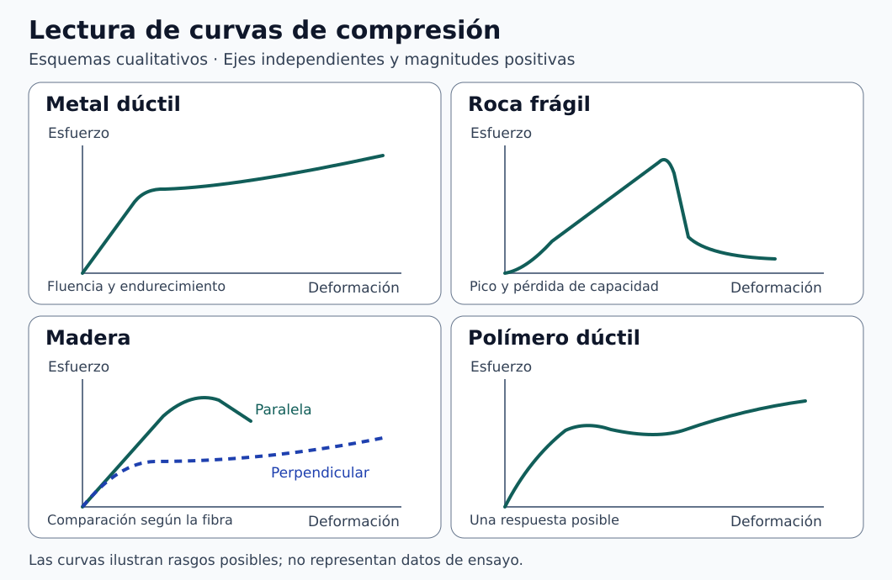

# Clase 03 · Compresión y selección de materiales

**Asignatura:** Biomecánica  
**Docente:** David Cortez Saravia  
**Fecha:** 4 de noviembre de 2026

[Clase anterior · Jacobiano, esfuerzo y deformación](../clase-02-jacobiano-esfuerzo/README.md)

En esta clase retomamos el esfuerzo y la deformación para interpretar ensayos de compresión. Comparamos la respuesta de metales, rocas, madera y polímeros, y dejamos planteada una pregunta para la selección de materiales: ¿qué propiedades necesitamos comprobar antes de escoger un candidato?

## Grabación de la clase

[Ingresar a AVAC con la cuenta institucional](https://avac.ups.edu.ec/). Abre el aula de la asignatura y busca la grabación por la fecha de la sesión, si está habilitada.

## De la carga a la curva esfuerzo–deformación

En un ensayo axial, $`F`$ es la magnitud de la fuerza, $`A_0`$ el área transversal inicial y $`L_0`$ la longitud inicial de referencia. Para representar la compresión con magnitudes positivas, usamos el acortamiento $`L_0-L`$:

```math
\sigma_c=\frac{F}{A_0},
\qquad
\varepsilon_c=\frac{L_0-L}{L_0}.
```

Son medidas de ingeniería, calculadas respecto a la geometría inicial. Si se adopta la convención habitual de tracción positiva, el esfuerzo y la deformación axial en compresión llevan signo negativo. La deformación unitaria es adimensional y se puede expresar en porcentaje. El esfuerzo se mide en Pa y $`1\,\mathrm{MPa}=1\,\mathrm{N/mm^2}`$. [1]

En el tramo elástico lineal, la pendiente de la curva es el módulo de Young en la dirección del ensayo:

```math
E=\frac{\Delta\sigma_c}{\Delta\varepsilon_c},
\qquad
\sigma_c=E\varepsilon_c.
```

La segunda expresión supone un tramo lineal que pasa por el origen. Fuera de ese tramo, el cociente entre esfuerzo y deformación desde el origen es un **módulo secante** al punto escogido. La pendiente local es un **módulo tangente**. Conviene indicar el intervalo y el método cuando se reporta un módulo. La recuperación al descargar distingue la deformación elástica de la permanente. Un tramo recuperable puede ser no lineal. [1]

### Carga oblicua sobre un plano

Si el ángulo $`\theta`$ se mide **desde la normal al plano** y la carga actúa sobre un área $`A`$, las magnitudes nominales promedio de las componentes normal y cortante son:

```math
|\sigma_n|=\frac{F\cos\theta}{A},
\qquad
|\tau|=\frac{F\sin\theta}{A},
\qquad 0\leq\theta\leq90^\circ.
```

Aquí $`A`$ corresponde al plano analizado. La descomposición sirve para identificar componentes de carga. Determinar la orientación de una fractura exige conocer el estado de esfuerzos y el criterio de falla del material.

## Qué observar al comparar las curvas



*Figura 1. Esquemas cualitativos con ejes independientes. [Descripción en texto](figuras/DESCRIPCIONES.md) · [Créditos](figuras/CREDITOS.md).*

| Familia o caso | Rasgo que conviene observar | Condición que cambia la interpretación |
| --- | --- | --- |
| **Metal dúctil** | Tramo inicial, fluencia y posible aumento del esfuerzo con la deformación plástica | La estricción y la caída del esfuerzo de ingeniería por reducción localizada de área se asocian al ensayo de tracción. En compresión, la fricción con los platos puede producir abarrilamiento. |
| **Roca, ejemplo de respuesta frágil** | Pico de esfuerzo y posible pérdida de capacidad después del pico | La litología, el confinamiento y el sistema de ensayo influyen en la curva. Una meseta de fluencia no es un rasgo general de las rocas. |
| **Madera** | Diferencias entre compresión paralela y perpendicular a la fibra | La especie, humedad y orientación importan. En dirección perpendicular puede predominar el aplastamiento progresivo. Comprueben el criterio con que se reporta el esfuerzo antes de comparar valores. [2] |
| **Polímero** | Pendiente inicial y evolución del esfuerzo tras la fluencia, si aparece | La temperatura, la velocidad de deformación y la composición afectan la respuesta. Una curva dúctil es solo uno de los casos posibles. |

Una **espuma** se distingue por su estructura celular, que puede ser metálica o polimérica. En muchas espumas se observa un tramo inicial, una región de colapso celular con aumento moderado del esfuerzo y, a deformaciones mayores, densificación. Al comparar una espuma metálica con un acero macizo hay que distinguir la arquitectura celular de la composición.

Rigidez, resistencia y tenacidad son propiedades diferentes. La rigidez describe cuánto cambia la deformación frente a una carga. En la curva del material, el módulo mide la pendiente elástica. La resistencia corresponde a un esfuerzo asociado a un criterio definido, por ejemplo fluencia o máximo. La tenacidad de una probeta evaluada a partir de una curva de **tracción hasta rotura** se relaciona con la energía absorbida por unidad de volumen. Por eso, traducir *tough* como «duro» confunde tenacidad con dureza. [1]

## Ejercicio complementario · Obtener un módulo aparente

Supongan una probeta de sección inicial $`100\,\mathrm{mm^2}`$ y longitud de referencia $`50\,\mathrm{mm}`$. En el tramo lineal se registran dos puntos: una fuerza de 1 000 N con acortamiento de 0,05 mm y una fuerza de 2 000 N con acortamiento de 0,10 mm. Los valores son didácticos.

| Punto | Esfuerzo de ingeniería | Deformación de ingeniería |
| --- | --- | --- |
| 1 | 10 MPa | 0,001 (0,10 %) |
| 2 | 20 MPa | 0,002 (0,20 %) |

```math
E=\frac{20-10}{0.002-0.001}\,\mathrm{MPa}
=10\,000\,\mathrm{MPa}=10\,\mathrm{GPa}.
```

La pendiente corresponde al intervalo indicado. Para interpretar un ensayo real, comprueben cómo se midió el acortamiento. Si se tomó solo del desplazamiento del cabezal, el registro puede incluir deformación del equipo y asentamiento de la probeta. Los dos puntos no indican la resistencia máxima ni permiten identificar el material.

## De la caracterización a la selección

Un **diagrama de Ashby** cruza dos propiedades, por ejemplo módulo elástico y densidad, y permite visualizar familias de materiales. Para usarlo, definan primero la función del componente, sus restricciones y el objetivo de diseño. Después pueden filtrar candidatos, compararlos y revisar si el proceso de fabricación y las condiciones de servicio son compatibles. La clase introdujo el diagrama como preparación para profundizar en su uso.

| Herramienta | Para qué usarla |
| --- | --- |
| **Diagrama de Ashby** | Comparar candidatos según propiedades y restricciones de diseño. |
| **Ishikawa** | Organizar hipótesis sobre las causas de un problema, por ejemplo la dispersión de resultados en compresión. Las hipótesis se contrastan con evidencia. |
| **5 porqués** | Profundizar en una hipótesis causal. El número de preguntas sirve de guía y cada respuesta debe contrastarse. |
| **5S** | Ordenar y estandarizar el puesto de trabajo y los registros de ensayo. |

En una **placa de fijación ósea**, la selección es un problema del dispositivo completo. A la respuesta mecánica y la fabricación se suman el tipo y la duración del contacto con el cuerpo, la superficie y las condiciones de uso. La evaluación biológica se plantea dentro de la gestión de riesgos del dispositivo terminado. La elección de una familia de materiales es un paso preliminar. [3]

## Actividad de estudio

Dibujen lado a lado cuatro esquemas de esfuerzo–deformación en compresión: metal dúctil, roca frágil, madera y polímero. Para la madera, incluyan la comparación paralela y perpendicular a la fibra. Rotulen los ejes y marquen solamente los rasgos que correspondan a cada caso. Si usan una gráfica experimental, anoten la fuente, el material y las condiciones de ensayo disponibles. En un esquema cualitativo, dejen los ejes sin valores numéricos.

Resuelvan el ejercicio de la probeta y expliquen qué información adicional necesitarían para comparar dos candidatos para una aplicación biomecánica.

## Referencias de apoyo

1. D. Roylance, MIT. [Stress–Strain Curves](https://web.mit.edu/course/3/3.11/www/modules/ss.pdf). Medidas de ingeniería y lectura de curvas con ejemplos principalmente de tracción.
2. USDA Forest Products Laboratory. [Wood Handbook: Wood as an Engineering Material, capítulo 5](https://research.fs.usda.gov/treesearch/62244). Propiedades mecánicas y efecto de la dirección de la fibra.
3. FDA. [Biological evaluation of medical devices within a risk management process](https://www.fda.gov/regulatory-information/search-fda-guidance-documents/use-international-standard-iso-10993-1-biological-evaluation-medical-devices-part-1-evaluation-and). Referencia técnica para contextualizar la evaluación biológica.

---

[Volver a Biomecánica](../../README.md) · [Volver al portafolio](../../../../README.md)
