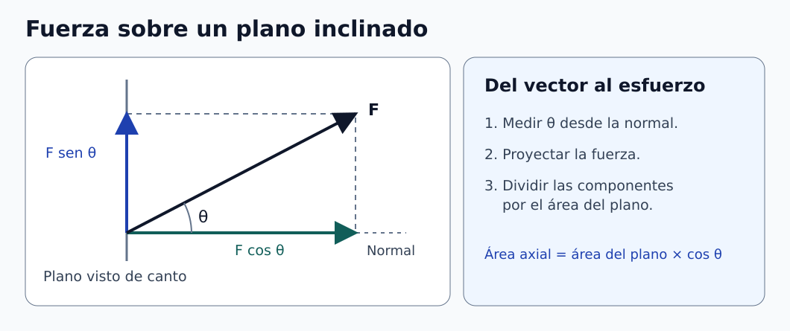

# Clase 02 · Jacobiano, esfuerzo y deformación

**Asignatura:** Biomecánica  
**Docente:** David Cortez Saravia  
**Fecha:** 28 de octubre de 2026

[Clase anterior · Movimiento y medio continuo](../clase-01-introduccion/README.md) · [Clase siguiente · Compresión y selección de materiales](../clase-02-compresion-materiales/README.md)

La sesión conectó dos formas de estudiar un sólido. La cinemática describe cómo cambian las posiciones de sus puntos. La mecánica de sólidos añade las fuerzas internas y la respuesta del material. Repasamos el cálculo del jacobiano y pasamos de una carga axial a las componentes de esfuerzo sobre un plano inclinado.

## Del movimiento al cambio local de volumen

La posición de un punto material se escribe $`\mathbf{x}=\boldsymbol{\chi}(\mathbf{X},t)`$, con $`\mathbf{X}`$ en la configuración de referencia. Si seguimos el mismo punto material, la velocidad y la aceleración se obtienen derivando su posición respecto al tiempo. Si fijamos el instante y derivamos respecto a la posición de referencia, obtenemos el **gradiente de deformación**.

```math
\mathbf{F}=\frac{\partial\boldsymbol{\chi}}{\partial\mathbf{X}},
\qquad F_{ij}=\frac{\partial x_i}{\partial X_j},
\qquad J=\det\mathbf{F}.
```

La matriz $`\mathbf{F}`$ describe cambios locales de dirección y longitud. Su determinante $`J`$ indica el factor local de cambio de volumen para un movimiento que preserva la orientación. En un movimiento rígido, $`\mathbf{F}`$ es la rotación y $`J=1`$. La traslación no contribuye a las derivadas espaciales.

En clase se obtuvo un determinante exponencial. El siguiente **ejemplo complementario** reproduce esa forma con un campo sencillo, sin reconstruir las ecuaciones originales. Sea $`\alpha=2\,\mathrm{s^{-1}}`$ y sea $`t`$ el tiempo medido en segundos.

```math
\boldsymbol{\chi}(\mathbf{X},t)=(e^{\alpha t}X,\,Y,\,Z),
\qquad
\mathbf{F}=
\begin{bmatrix}
e^{\alpha t}&0&0\\[0pt]
0&1&0\\[0pt]
0&0&1
\end{bmatrix},
\qquad J=e^{\alpha t}.
```

Cada fila reúne las derivadas de una coordenada actual respecto a todas las coordenadas de referencia. El determinante es positivo para todo tiempo finito. En general, un determinante no nulo garantiza invertibilidad **local** para un campo continuamente diferenciable. En este ejemplo la inversa global también es explícita: $`X=e^{-\alpha t}x,\ Y=y,\ Z=z`$. La matriz inversa representa la derivada del movimiento inverso, evaluada en el punto correspondiente.

## Vector de tracción y plano inclinado

El vector de tracción se define sobre una superficie orientada por su normal unitaria $`\mathbf{n}`$. Su definición local toma el límite respecto al área del parche, a tiempo fijo. Para una superficie en la configuración actual, el tensor de Cauchy $`\boldsymbol{\sigma}`$ relaciona la normal con el vector de tracción. [1]

```math
\mathbf{t}^{(\mathbf n)}=
\lim_{\Delta A\to0}\frac{\Delta\mathbf f}{\Delta A}
=\boldsymbol{\sigma}\mathbf n,\qquad
\sigma_n=\mathbf t^{(\mathbf n)}\cdot\mathbf n,\qquad
\boldsymbol{\tau}=\mathbf t^{(\mathbf n)}-\sigma_n\mathbf n.
```

Para una barra bajo carga uniaxial uniforme, sea $`A_\perp`$ el área normal al eje y $`A_\theta`$ el área del plano inclinado. El ángulo $`\theta`$ se mide **entre el eje de carga y la normal al plano**. Para $`0\leq\theta<90^\circ`$, la proyección del área cumple $`A_\perp=A_\theta\cos\theta`$. Las componentes de fuerza sobre el plano son $`F\cos\theta`$ y $`F\sin\theta`$. Dividir ambas por $`A_\theta`$ da las magnitudes nominales: [1]

```math
\sigma_{\mathrm{ax}}=\frac{F}{A_\perp},
\qquad
|\sigma_n|=\sigma_{\mathrm{ax}}\cos^2\theta,
\qquad
\|\boldsymbol{\tau}\|=\sigma_{\mathrm{ax}}\sin\theta\cos\theta.
```



*Figura 1. Proyecciones sobre un plano inclinado. [Descripción en texto](figuras/DESCRIPCIONES.md) · [Créditos](figuras/CREDITOS.md).*

La relación pitagórica para las componentes usa la magnitud de la **tracción sobre el plano inclinado**, que en este caso es $`\sigma_{\mathrm{ax}}\cos\theta`$. Por ejemplo, si el esfuerzo axial es 12 MPa y el ángulo es 30°, el esfuerzo normal tiene magnitud 9 MPa y el cortante aproximadamente 5,20 MPa. El coseno adicional de las expresiones anteriores aparece por la proyección del área.

## Esfuerzo axial, deformación y módulo de Young

Para las medidas de ingeniería se usan el área y la longitud iniciales, $`A_0`$ y $`L_0`$. Con tracción positiva, el esfuerzo y la deformación axial son negativos en compresión. En un tramo elástico lineal, el módulo de Young es la pendiente de la curva. [2]

```math
\sigma_{\mathrm{ing}}=\frac{F_{\mathrm{ax}}}{A_0},
\qquad
\varepsilon_{\mathrm{ing}}=\frac{L-L_0}{L_0},
\qquad
E=\frac{\Delta\sigma_{\mathrm{ing}}}{\Delta\varepsilon_{\mathrm{ing}}}.
```

El módulo mide rigidez del material en el régimen analizado. La resistencia, la deformación de rotura y la fragilidad requieren información adicional de la curva o de otros ensayos. En tendones o huesos también interesa la dirección de carga y el intervalo medido. Un cálculo de esfuerzo nominal bajo peso estático no basta para predecir una fractura durante una caída. Para plantear ese problema habría que conocer, entre otros factores, la carga dinámica, el apoyo y la geometría.

### Ejercicio 1 · Revisar las unidades

Si se toman literalmente los datos del enunciado, una carga de 60 N sobre 0,02 mm² da 3 000 N/mm², es decir **3 000 MPa**. Una deformación de 0,3 % equivale a 0,003. El cociente secante es **1 000 000 MPa (1 TPa)**. Interpretarlo como módulo de Young requeriría confirmar que el dato pertenece al tramo elástico lineal. Antes de usar el resultado como propiedad de la barra, revisen el área, las unidades y el registro de ensayo.

### Ejercicio 2 · Comprobar el límite del modelo

Para un alambre de radio 0,03 mm, el área inicial es aproximadamente 0,00283 mm². Una fuerza de 90 N da un esfuerzo nominal de **31,8 GPa**. Si se extrapola la ley lineal con 200 GPa, el cálculo formal da una deformación de 0,159. Esa extrapolación queda fuera del régimen lineal esperado para un alambre de acero. La longitud de 2,32 m que sale de la operación no es una predicción física.

Como **variante didáctica**, prueben con un radio de 0,30 mm y los demás datos iguales. Se obtienen aproximadamente 318 MPa y, si el material sigue en su tramo elástico lineal bajo esa carga, un alargamiento de 3,18 mm para una longitud inicial de 2 m. El límite de fluencia de la aleación concreta permitiría comprobar esa condición.

## Para practicar

1. Formen la matriz del ejemplo y expliquen qué representa su determinante. Identifiquen qué se mantiene fijo al derivar.
2. Calculen el esfuerzo normal y el cortante para 12 MPa de esfuerzo axial y un ángulo de 45°. Indiquen el área usada en cada paso.
3. Rehagan los ejercicios con unidades coherentes. Indiquen qué dato del material o del ensayo falta antes de interpretar cada resultado.

## Referencias de apoyo

1. D. Roylance, MIT. [Transformation of Stresses and Strains](https://web.mit.edu/course/3/3.11/www/modules/trans.pdf). Equilibrio en un plano inclinado y transformación de esfuerzos.
2. D. Roylance, MIT. [Stress–Strain Curves](https://web.mit.edu/course/3/3.11/www/modules/ss.pdf). Medidas de ingeniería e interpretación de la pendiente elástica.

[Volver a Biomecánica](../../README.md) · [Volver al portafolio](../../../../README.md)
