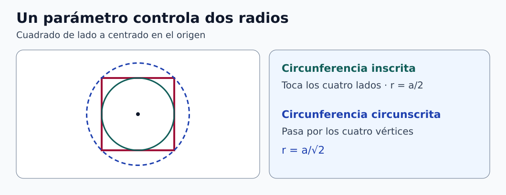

# Clase 04 · Del comportamiento de materiales al croquis paramétrico

**Asignatura:** Biomecánica  
**Docente:** David Cortez Saravia  
**Fecha de referencia:** 11 de noviembre de 2026

[Ver la clase anterior](../clase-02-compresion-materiales/README.md)

La sesión retomó las curvas esfuerzo–deformación y pasó al croquizado paramétrico en SolidWorks y Onshape. El vínculo con el diseño consiste en distinguir qué dimensiones pueden variar y qué relaciones deben conservarse entre versiones.

## Qué recordar de las curvas

En un ensayo uniaxial, el esfuerzo nominal divide la fuerza por el área inicial y la deformación nominal divide el cambio de longitud por la longitud inicial. El módulo de Young corresponde a la pendiente elástica lineal en la dirección ensayada. En madera interesa la orientación respecto a la fibra. En las espumas, la densificación ocurre cuando el espacio disponible entre las celdas se reduce y el esfuerzo aumenta con rapidez al seguir comprimiendo. La [clase anterior](../clase-02-compresion-materiales/README.md) desarrolla estos comportamientos.

La geometría CAD y la respuesta mecánica son preguntas diferentes. En una pieza impresa conviene documentar cómo se fabricó y ensayó antes de atribuirle propiedades a partir de una ficha del material.

## Construir un croquis que se pueda modificar

1. Definan el plano y el origen según el propósito del modelo.
2. Construyan líneas, rectángulos y círculos con las relaciones necesarias. Por ejemplo, fijen una esquina al origen y conserven la horizontalidad y verticalidad de los lados.
3. Añadan cotas conductoras para los parámetros que van a modificar. Comprueben que las relaciones mantienen la intención de diseño.
4. Comprueben el estado del croquis. Si una entidad aún se desplaza, identifiquen qué relación o cota falta. Si aparece una definición excesiva, localicen las restricciones redundantes o incompatibles.

En Onshape las relaciones y cotas se aplican dentro del croquis. Las variables pueden vincularse a sus dimensiones. En SolidWorks se pueden gestionar parámetros mediante ecuaciones y variables globales. [1, 2]



*Figura 1. Cuadrado y circunferencias. [Descripción en texto](figuras/DESCRIPCIONES.md) · [Créditos](figuras/CREDITOS.md).*

**Ejemplo complementario.** En un cuadrado de lado $`a`$ centrado en el origen, la circunferencia inscrita toca los **cuatro lados**. La circunscrita pasa por los **cuatro vértices**. Con un cuadrado ya definido, bastan relaciones independientes para determinar el centro y el radio. Las demás coincidencias se comprueban geométricamente.

```math
r_{\mathrm{inscrito}}=\frac{a}{2},\qquad
r_{\mathrm{circunscrito}}=\frac{a}{\sqrt 2}.
```

Con un lado de 40 mm se obtienen radios de 20 mm y 28,28 mm. Si el lado cambia a 60 mm, los radios pasan a 30 mm y 42,43 mm. Las relaciones se mantienen mientras cambia el parámetro.

## Para practicar

Dibujen el cuadrado y las dos circunferencias como geometrías de referencia o en croquis separados. Cambien el lado de 40 a 60 mm y verifiquen los radios. Para la **Práctica de Diseño 1**, consulten la figura y el formato de entrega de AVAC.

## Referencias

1. PTC. [Fundamentos de croquis en Onshape](https://cad.onshape.com/help/Content/Sketch/sketch_basics.htm).
2. Dassault Systèmes. [Ecuaciones y variables en SolidWorks](https://help.solidworks.com/2025/english/SolidWorks/sldworks/c_configuring_equations.htm).

[Volver a Biomecánica](../../README.md) · [Volver al portafolio](../../../../README.md)
