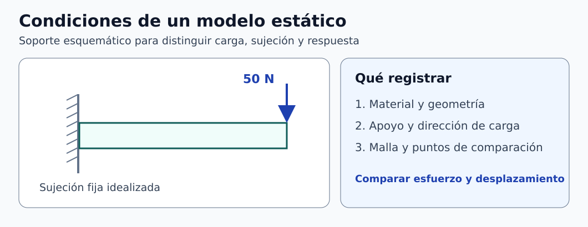

# Clase 05 · Modelado paramétrico y simulación estática

**Asignatura:** Biomecánica  
**Docente:** David Cortez Saravia  
**Fecha de referencia:** 12 de noviembre de 2026

[Ver la clase anterior](../clase-04-croquis-parametrico/README.md)

La práctica pasó de un croquis extruido a un estudio estático en SolidWorks. Se revisaron las propiedades de masa y se compararon configuraciones con distintas dimensiones. El objetivo fue aprender a documentar el modelo y a interpretar sus resultados.

## Del croquis al modelo de análisis

1. Definan el croquis, distinguiendo la longitud de un segmento oblicuo de sus proyecciones horizontal y vertical. Extruyan el perfil con el espesor indicado en la práctica.
2. Asignen el material y revisen sus propiedades. En **Propiedades físicas**, comprueben qué cuerpos están incluidos, las unidades y si existen valores sobrescritos. Para un cuerpo homogéneo, la masa calculada se puede contrastar con su densidad por su volumen. [1]
3. Creen un estudio estático y documenten las superficies de sujeción, la zona cargada, la dirección y la magnitud. En la demostración se fijaron tres caras y se aplicó una fuerza de **50 N** en una cara oblicua. Una masa de 5 kg pesa aproximadamente 49,0 N bajo la gravedad estándar.
4. Generen la malla, resuelvan y consulten los gráficos de desplazamiento y esfuerzo equivalente de von Mises. Guarden las unidades y la escala. Una vista deformada puede estar amplificada para hacer visible el desplazamiento.



*Figura 1. Modelo de carga estática. [Descripción en texto](figuras/DESCRIPCIONES.md) · [Créditos](figuras/CREDITOS.md).*

## Leer los resultados y comprobar la malla

El módulo de Young $`E`$ mide la rigidez elástica y participa en el cálculo de deformaciones. Para evaluar **inicio de fluencia** en un metal dúctil bajo un criterio de von Mises, la comparación corresponde al límite de fluencia $`\sigma_y`$. Con un máximo representativo y un modelo aplicable, el cociente $`\sigma_y/\sigma_{\mathrm{vM}}`$ estima un factor frente a la fluencia para la carga analizada. Ese resultado depende de los supuestos, la geometría y las condiciones de frontera. [2]

Una malla automática permite comenzar. Para sustentar una comparación, refinen la malla y revisen cómo cambian el desplazamiento en un punto de control y el esfuerzo en una región comparable. Un pico que aumenta al refinar cerca de una esquina idealizada o de una carga concentrada puede indicar una singularidad. Revisen el modelo antes de utilizarlo como criterio. [3]

## Comparar configuraciones

Vinculen las cotas a variables globales y apliquen cada conjunto de valores a su configuración. Mantengan iguales el material, la carga, el criterio de sujeción y la estrategia de malla cuando el objetivo sea comparar geometrías. Comprueben que las caras seleccionadas conservan el mismo significado físico. Si cambian dos dimensiones a la vez, la comparación corresponde al efecto conjunto. Cambien una a la vez para estudiar su aporte por separado. [4]

| Registro | Qué comparar |
| --- | --- |
| Geometría | Cotas modificadas y espesor |
| Modelo | Material, carga, apoyos y malla |
| Respuesta | Masa, desplazamiento en un punto y esfuerzo en una región definida |

**Ejemplo complementario de verificación.** Para una barra prismática homogénea con área de 200 mm², longitud de 100 mm y densidad supuesta de 7850 kg/m³, el volumen es 20 000 mm³ y la masa es 0,157 kg. Este cálculo ilustra la revisión de unidades con una geometría simple.

```math
m=\rho V
=7850\ \mathrm{kg/m^3}\,(2.0\times10^{-5}\ \mathrm{m^3})
=0.157\ \mathrm{kg}.
```

## Para practicar

Repitan el flujo con la pieza de la práctica. Guarden dos configuraciones, expliquen qué dimensión cambia y comparen masa, desplazamiento y esfuerzo con unidades. Incluyan la ubicación de la carga, las sujeciones y un refinamiento de malla para justificar qué resultados son comparables.

## Referencias

1. Dassault Systèmes. [Propiedades de masa y sección](https://help.solidworks.com/2025/english/SolidWorks/sldworks/c_Mass_and_Section_Properties_Overview.htm).
2. Dassault Systèmes. [Guía de SolidWorks Simulation, criterio de von Mises](https://www.solidworks.com/sw/images/content/Training/SolidWorks_Simulation_Student_Guide-ENG.pdf).
3. Dassault Systèmes. [Refinamiento de malla y singularidades de esfuerzo](https://help.solidworks.com/2025/english/SolidWorks/cworks/IDC_HELP_PRESTATIC_P_ADAPTIVE.htm).
4. Dassault Systèmes. [Configuración de ecuaciones y variables](https://help.solidworks.com/2025/english/SolidWorks/sldworks/c_configuring_equations.htm).

[Volver a Biomecánica](../../README.md) · [Volver al portafolio](../../../../README.md)
