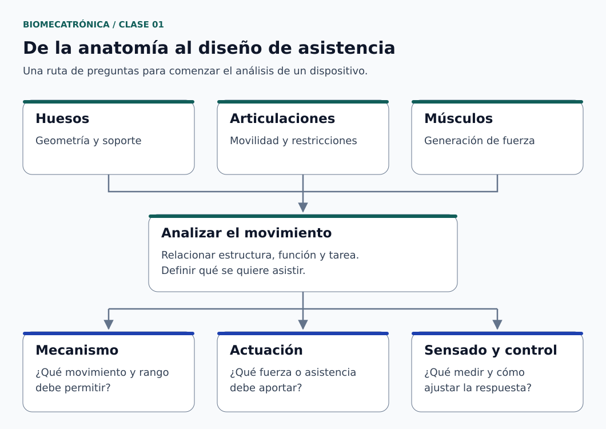
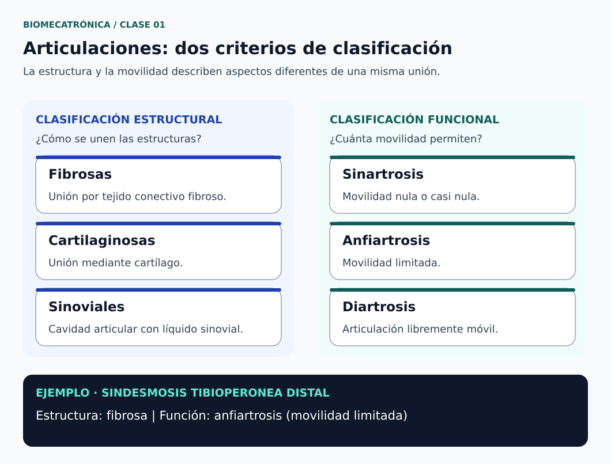

# Clase 01 · Introducción a la biomecatrónica y al movimiento humano

**Asignatura:** Biomecatrónica  
**Docente:** David Cortez Saravia  
**Fecha de referencia:** 26 de octubre de 2026, según el archivo recibido  
**Modalidad:** teletrabajo

## El punto de partida

Para diseñar un dispositivo que interactúe con el cuerpo humano, primero necesitamos comprender qué estructura vamos a asistir y cómo participa en el movimiento. Con esa idea comenzó la asignatura: relacionar anatomía y fisiología con los conocimientos de mecánica, sensórica y control de la carrera.

La sesión presentó el enfoque del curso e introdujo huesos, articulaciones y funciones musculares. También se discutieron ejemplos de robótica blanda como punto de conexión con los dispositivos de asistencia y rehabilitación.

*Figura 1. Ruta de análisis desde la anatomía hacia el diseño de asistencia. Elaboración original para el portafolio; síntesis didáctica. [Créditos y alcance](figuras/CREDITOS.md).*

## Propósito de la sesión

Introducir las bases anatómicas necesarias para comenzar a analizar el movimiento desde la ingeniería. El propósito fue reconocer estructuras y funciones antes de plantear mecanismos que interactúen con ellas. Este objetivo describe la intención de la clase; no constituye una medición del aprendizaje alcanzado.

## Contenidos trabajados

### Robótica blanda como contexto de aplicación

Según el resumen de la sesión, se presentaron ejemplos audiovisuales de robots con movimiento por expansión y contracción, estructuras con tentáculos y actuadores neumáticos. Estos ejemplos permitieron introducir la relación entre deformación y movimiento.

La robótica blanda utiliza componentes deformables y no se limita a la neumática: también existen soluciones hidráulicas, eléctricas y basadas en materiales activos. En esta clase, la atención se concentró en ejemplos neumáticos. Su costo, consumo y masa deben evaluarse considerando el sistema completo, incluida la alimentación y el control; no son ventajas garantizadas por utilizar aire comprimido. [1]

### Huesos: la forma importa más que el tamaño

La clasificación por forma ayuda a organizar el estudio del esqueleto. Un hueso pequeño también puede ser largo, como ocurre con las falanges. [2]

| Tipo | Ejemplos |
| --- | --- |
| Largo | Fémur, húmero y falanges |
| Corto | Huesos del carpo y del tarso |
| Plano | Escápula y esternón |
| Irregular | Vértebras |
| Sesamoideo | Rótula |

La rótula se incorpora aquí para completar la clasificación anatómica de referencia. La tabla es una síntesis editorial verificada, no una transcripción literal de la exposición.

### Articulaciones: distinguir estructura y movilidad

Se revisaron dos criterios que responden a preguntas diferentes: cómo se unen las estructuras y cuánto movimiento permiten. [3]

| Criterio | Categoría | Descripción breve |
| --- | --- | --- |
| Estructural | Fibrosa | Unión mediante tejido conectivo fibroso |
| Estructural | Cartilaginosa | Unión mediante cartílago |
| Estructural | Sinovial | Presencia de una cavidad articular con líquido sinovial |
| Funcional | Sinartrosis | Movilidad nula o prácticamente nula |
| Funcional | Anfiartrosis | Movilidad limitada |
| Funcional | Diartrosis | Articulación libremente móvil |

La sindesmosis tibioperonea distal es un ejemplo útil: estructuralmente es fibrosa y funcionalmente permite un movimiento limitado. Por ello, no corresponde describirla como una unión completamente inmóvil. [4]

*Figura 2. Dos criterios de clasificación articular. El ejemplo muestra por qué una articulación fibrosa no es necesariamente inmóvil. Fundamento: referencias 3 y 4. [Créditos](figuras/CREDITOS.md).*

### Músculos: funciones que dependen del movimiento

Los términos agonista, antagonista, sinérgico y fijador describen la participación muscular en una acción concreta. El agonista contribuye principalmente al movimiento; el antagonista tiene una acción opuesta; el sinérgico ayuda; y el fijador estabiliza una estructura necesaria para la acción. Un mismo músculo puede cambiar de función al cambiar el movimiento analizado. [5]

Esta distinción permite introducir una pregunta de diseño: ¿cómo se coordina la generación de fuerza con la estabilidad del mecanismo?

### Propiocepción y retroalimentación

La propiocepción permite percibir la posición y el movimiento de las partes del cuerpo. [6] Durante la clase se utilizó una comparación con el control robótico para acercar este concepto a los estudiantes.

La analogía ayuda a discutir la importancia de la retroalimentación. Su alcance es didáctico: no establece que el control del movimiento humano sea un PID ni permite atribuir una alteración sensorial a una ganancia específica del controlador.

### Participación de la persona en el movimiento

Al introducir los dispositivos de rehabilitación conviene distinguir el movimiento pasivo, producido externamente sin participación activa de la persona, del activo, generado por ella. En el movimiento activo asistido, la persona participa y recibe ayuda para completar la acción. [7]

Esta distinción orienta la discusión sobre qué función cumpliría un dispositivo. No constituye una prescripción terapéutica ni demuestra la eficacia de los ejemplos presentados.

## Relación con el diseño de dispositivos

Como síntesis de ingeniería de los temas anteriores, el análisis de un dispositivo puede comenzar con tres preguntas:

1. ¿Qué estructura y qué movimiento se busca asistir?
2. ¿Qué elementos generan fuerza y cuáles aportan soporte o restricciones?
3. ¿Qué información necesitaría el sistema para ajustar su respuesta?

Los ligamentos pueden servir de referencia para discutir estabilidad y restricciones mecánicas; no deben equipararse directamente con actuadores. Del mismo modo, clasificar una articulación no determina por sí solo qué actuador debe utilizarse. Estas preguntas son una organización editorial del contenido, no una actividad evaluada que se atribuya a la sesión.

## Continuidad del trabajo

El resumen recibido registra el estudio de huesos principales, la revisión de terminología anatómica y la lectura de un proyecto o publicación para participar en un foro. Los enlaces, las instrucciones exactas y los plazos deben consultarse en el aula virtual; no se reproducen aquí porque requieren confirmación.

## Referencias de verificación

Consultadas el 27 de octubre de 2026. Las fuentes anatómicas se utilizan para conceptos de base; su antigüedad no implica que describan avances tecnológicos recientes.

1. Pan et al. (2022). *Soft Actuators and Robotic Devices for Rehabilitation and Assistance*. Advanced Intelligent Systems. [Artículo y DOI](https://doi.org/10.1002/aisy.202100140).
2. OpenStax. *Anatomy and Physiology 2e*, sección 6.2: [Bone Classification](https://openstax.org/books/anatomy-and-physiology-2e/pages/6-2-bone-classification).
3. OpenStax. *Anatomy and Physiology 2e*, sección 9.1: [Classification of Joints](https://openstax.org/books/anatomy-and-physiology-2e/pages/9-1-classification-of-joints).
4. OpenStax. *Anatomy and Physiology 2e*, sección 9.2: [Fibrous Joints](https://openstax.org/books/anatomy-and-physiology-2e/pages/9-2-fibrous-joints).
5. OpenStax. *Anatomy and Physiology 2e*, sección 11.1: [Interactions of Skeletal Muscles, Their Fascicle Arrangement, and Their Lever Systems](https://openstax.org/books/anatomy-and-physiology-2e/pages/11-1-interactions-of-skeletal-muscles-their-fascicle-arrangement-and-their-lever-systems).
6. OpenStax. *Anatomy and Physiology 2e*, sección 16.4: [The Sensory and Motor Exams](https://openstax.org/books/anatomy-and-physiology-2e/pages/16-4-the-sensory-and-motor-exams).
7. MSD Manual, edición profesional. [Physical Therapy (PT), apartado Range of motion](https://www.msdmanuals.com/professional/special-subjects/rehabilitation/physical-therapy-pt).

---

[Volver a Biomecatrónica](../../README.md) · [Ver asignaturas](../../../README.md) · [Volver al portafolio](../../../../README.md)
