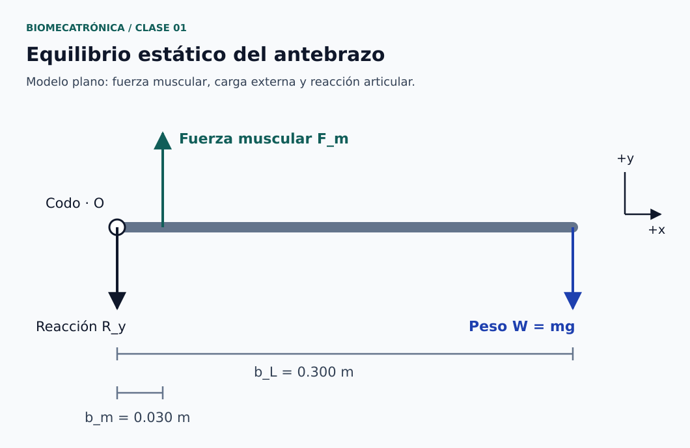

# Clase 01 · Introducción a la biomecatrónica y al movimiento humano

**Asignatura:** Biomecatrónica  
**Docente:** David Cortez Saravia  
**Fecha de referencia:** 26 de octubre de 2026, según el archivo recibido  
**Modalidad:** teletrabajo

## El punto de partida

Para diseñar un dispositivo que interactúe con el cuerpo humano, primero necesitamos comprender qué estructura vamos a asistir y cómo participa en el movimiento. Con esa idea comenzó la asignatura: relacionar anatomía y fisiología con los conocimientos de mecánica, sensórica y control de la carrera.

La sesión presentó el enfoque del curso e introdujo huesos, articulaciones y funciones musculares. También se discutieron ejemplos de robótica blanda como punto de conexión con los dispositivos de asistencia y rehabilitación.


*Figura 1. De la anatomía al diseño de asistencia. [Créditos](figuras/CREDITOS.md) · [Descripción en texto](figuras/DESCRIPCIONES.md#figura-1).*

## Propósito de la sesión

Introducir las bases anatómicas necesarias para comenzar a analizar el movimiento desde la ingeniería. El propósito fue reconocer estructuras y funciones antes de plantear mecanismos que interactúen con ellas.

## Contenidos trabajados

### Robótica blanda como contexto de aplicación

Durante la clase se presentaron ejemplos audiovisuales de robots con movimiento por expansión y contracción, estructuras con tentáculos y actuadores neumáticos. Estos ejemplos permitieron introducir la relación entre deformación y movimiento.

La robótica blanda utiliza componentes deformables y no se limita a la neumática: también existen soluciones hidráulicas, eléctricas y basadas en materiales activos. En esta clase, la atención se concentró en ejemplos neumáticos. Su costo, consumo y masa deben evaluarse considerando el sistema completo, incluida la alimentación y el control; no son ventajas garantizadas por utilizar aire comprimido. [1]

### Huesos: la forma importa más que el tamaño

La clasificación por forma ayuda a organizar el estudio del esqueleto. Un hueso pequeño también puede ser largo, como ocurre con las falanges. [2]

| Tipo | Ejemplos |
| --- | --- |
| Largo | Fémur, húmero y falanges |
| Corto | Huesos del carpo y del tarso |
| Plano | Escápula y esternón |
| Irregular | Vértebras |
| Sesamoideo | Rótula |

La rótula permite reconocer otra categoría importante: los huesos sesamoideos.

### Articulaciones: distinguir estructura y movilidad

Se revisaron dos criterios que responden a preguntas diferentes: cómo se unen las estructuras y cuánto movimiento permiten. [3]

| Criterio | Categoría | Descripción breve |
| --- | --- | --- |
| Estructural | Fibrosa | Unión mediante tejido conectivo fibroso |
| Estructural | Cartilaginosa | Unión mediante cartílago |
| Estructural | Sinovial | Presencia de una cavidad articular con líquido sinovial |
| Funcional | Sinartrosis | Movilidad nula o prácticamente nula |
| Funcional | Anfiartrosis | Movilidad limitada |
| Funcional | Diartrosis | Articulación libremente móvil |

La sindesmosis tibioperonea distal es un ejemplo útil: estructuralmente es fibrosa y funcionalmente permite un movimiento limitado. Por ello, no corresponde describirla como una unión completamente inmóvil. [4]


*Figura 2. Clasificación estructural y funcional de las articulaciones. [Créditos y fuentes](figuras/CREDITOS.md) · [Descripción en texto](figuras/DESCRIPCIONES.md#figura-2).*

### Músculos: funciones que dependen del movimiento

Los términos agonista, antagonista, sinérgico y fijador describen la participación muscular en una acción concreta. El agonista contribuye principalmente al movimiento; el antagonista tiene una acción opuesta; el sinérgico ayuda; y el fijador estabiliza una estructura necesaria para la acción. Un mismo músculo puede cambiar de función al cambiar el movimiento analizado. [5]

Esta distinción permite introducir una pregunta de diseño: ¿cómo se coordina la generación de fuerza con la estabilidad del mecanismo?

### Propiocepción y retroalimentación

La propiocepción permite percibir la posición y el movimiento de las partes del cuerpo. [6] Durante la clase se utilizó una comparación con el control robótico para acercar este concepto a los estudiantes.

La analogía ayuda a discutir la importancia de la retroalimentación. Su alcance es didáctico: no establece que el control del movimiento humano sea un PID ni permite atribuir una alteración sensorial a una ganancia específica del controlador.

### Participación de la persona en el movimiento

Al introducir los dispositivos de rehabilitación conviene distinguir el movimiento pasivo, producido externamente sin participación activa de la persona, del activo, generado por ella. En el movimiento activo asistido, la persona participa y recibe ayuda para completar la acción. [7]

Esta distinción nos ayuda a definir qué participación tendría la persona y qué asistencia aportaría el dispositivo.

## Relación con el diseño de dispositivos

Como síntesis de ingeniería de los temas anteriores, el análisis de un dispositivo puede comenzar con tres preguntas:

1. ¿Qué estructura y qué movimiento se busca asistir?
2. ¿Qué elementos generan fuerza y cuáles aportan soporte o restricciones?
3. ¿Qué información necesitaría el sistema para ajustar su respuesta?

Los ligamentos pueden servir de referencia para discutir estabilidad y restricciones mecánicas; no deben equipararse directamente con actuadores. Del mismo modo, clasificar una articulación no determina por sí solo qué actuador debe utilizarse.

## Fundamento biomecánico complementario

Para conectar la anatomía con el cálculo ingenieril, añadimos un modelo sencillo de fuerzas y momentos. Este desarrollo amplía el resumen de la clase y propone un ejercicio de estudio.

### Momento de una fuerza

Respecto a un punto de referencia $`O`$, el momento de una fuerza se expresa como: [8]

```math
\boldsymbol{\tau}_O=\mathbf{r}\times\mathbf{F},
\qquad
|\tau_O|=rF\sin\theta=F b
```

| Símbolo | Significado | Unidad SI |
| --- | --- | --- |
| $`\boldsymbol{\tau}_O`$ | Momento de la fuerza respecto a $`O`$ | N·m |
| $`\mathbf{r}`$ | Vector desde $`O`$ hasta el punto de aplicación | m |
| $`\mathbf{F}`$ | Fuerza aplicada | N |
| $`\theta`$ | Ángulo entre $`\mathbf{r}`$ y $`\mathbf{F}`$ | rad |
| $`b=r\sin\theta`$ | Brazo de momento perpendicular, para $`0\leq\theta\leq\pi`$ | m |

El brazo de momento es la distancia perpendicular a la línea de acción de la fuerza. No debe confundirse con la longitud del hueso o con la distancia hasta una inserción. Si cambia la dirección de la fuerza, también puede cambiar su momento.

### Equilibrio estático

Para un cuerpo rígido en reposo dentro de un modelo plano: [8]

```math
\sum F_x=0,\qquad
\sum F_y=0,\qquad
\sum \tau_O=0
```

Tomaremos $`x`$ hacia la derecha, $`y`$ hacia arriba y el sentido antihorario como positivo para los momentos. El modelo es estático: para estudiar aceleraciones se necesitan las ecuaciones de la dinámica.

### Ejercicio: sostener una carga con el antebrazo

Representemos el antebrazo y la mano como una barra horizontal articulada en el codo. Una fuerza muscular equivalente $`F_m`$, vertical hacia arriba, equilibra el peso $`W`$ de una carga. La articulación aporta la reacción $`R_y`$. El uso de un modelo de palanca para estudiar fuerzas musculares se desarrolla en la referencia 9.



*Figura 3. Modelo plano del equilibrio del antebrazo. [Créditos](figuras/CREDITOS.md) · [Descripción en texto](figuras/DESCRIPCIONES.md#figura-3).*

**Datos elegidos para el ejercicio; no son mediciones de una persona:**

| Parámetro | Valor |
| --- | --- |
| Masa de la carga, $`m`$ | 2.00 kg |
| Aceleración gravitatoria adoptada, $`g`$ | 9.81 m/s² |
| Brazo de momento de la carga, $`b_L`$ | 0.300 m |
| Brazo de momento muscular, $`b_m`$ | 0.030 m |

**Supuestos:** barra rígida y horizontal, fuerzas verticales, articulación ideal sin momento de reacción y un único actuador muscular equivalente. Para aislar el efecto de los brazos de momento, se omiten el peso del antebrazo y de la mano, la cocontracción y las contribuciones pasivas.

Primero obtenemos el peso y su momento:

```math
W=mg=(2.00)(9.81)=19.62\ \mathrm{N}
```

```math
|\tau_L|=W b_L=(19.62)(0.300)=5.886\ \mathrm{N\,m}
```

Al tomar momentos respecto al codo, la reacción no contribuye porque se aplica en $`O`$:

```math
F_m b_m-W b_L=0
```

Por tanto:

```math
F_m=\frac{W b_L}{b_m}
=\frac{(19.62)(0.300)}{0.030}
=196.2\ \mathrm{N}
```

Completamos el equilibrio vertical:

```math
R_y+F_m-W=0
\quad\Rightarrow\quad
R_y=19.62-196.2=-176.58\ \mathrm{N}
```

El signo negativo indica que la reacción sobre la barra apunta hacia abajo. En esta geometría no hay cargas horizontales, de modo que $`R_x=0`$.

**Interpretación.** La fuerza muscular equivalente resulta diez veces mayor que el peso de la carga porque su brazo de momento es diez veces menor. Es una consecuencia del modelo de palanca, no una relación fija del cuerpo humano. Los resultados son valores nominales de los datos elegidos y no expresan precisión experimental.

El modelo ayuda a entender el efecto de la geometría, pero no estima la fuerza real de un músculo individual ni permite dimensionar por sí solo una prótesis o un dispositivo clínico. Un análisis más completo incorporaría los pesos segmentarios, las direcciones musculares y las condiciones de movimiento.

### Para explorar el modelo

Manteniendo los demás datos, ¿qué ocurre si el brazo de momento muscular aumenta a 0.040 m?

```math
F_m=\frac{5.886}{0.040}=147.15\ \mathrm{N}
```

La fuerza equivalente disminuye. Esto permite discutir por qué la ubicación y la dirección de aplicación de una fuerza son decisiones centrales en el diseño de mecanismos.

## Atlas y recursos de anatomía

| Recurso | Qué permite consultar | Uso propuesto |
| --- | --- | --- |
| [BlueLink Photographic Atlas — Universidad de Michigan](https://sites.google.com/a/umich.edu/bluelink/resources/bluelink) | Fotografías anatómicas organizadas por regiones | Localizar las estructuras y observar sus relaciones espaciales |
| [BlueLink Anatomy Tables — Universidad de Michigan](https://sites.google.com/a/umich.edu/bluelink/resources/bluelink-anatomy-tables) | Tablas de osteología y musculatura, entre otros sistemas | Repasar huesos, referencias óseas y músculos del miembro superior |
| [OpenStax — Bones of the Upper Limb](https://openstax.org/books/anatomy-and-physiology-2e/pages/8-2-bones-of-the-upper-limb) | Texto e ilustraciones sobre los huesos del miembro superior | Relacionar húmero, radio, cúbito y mano con el modelo mecánico |

Como recorrido de estudio, identifica primero las estructuras del miembro superior; después, ubica el eje del codo y distingue una distancia anatómica de un brazo de momento. El atlas aporta la referencia anatómica; las distancias del ejercicio son datos didácticos.

Los recursos se enlazan para su consulta. La reproducción de sus imágenes debe revisarse según las condiciones de cada fuente.

## Continuidad del trabajo

El resumen presentado aquí reúne las bases para continuar con el estudio de los huesos principales y la terminología anatómica. Como siguiente paso, queda la lectura de un proyecto o publicación para participar en el foro. Las instrucciones, los enlaces y las fechas de entrega se encuentran en el aula virtual.


## Referencias de apoyo

Fuentes consultadas para complementar y revisar los conceptos de este resumen. Consulta: 27 de octubre de 2026.

1. Pan et al. (2022). *Soft Actuators and Robotic Devices for Rehabilitation and Assistance*. Advanced Intelligent Systems. [Artículo y DOI](https://doi.org/10.1002/aisy.202100140).
2. OpenStax. *Anatomy and Physiology 2e*, sección 6.2: [Bone Classification](https://openstax.org/books/anatomy-and-physiology-2e/pages/6-2-bone-classification).
3. OpenStax. *Anatomy and Physiology 2e*, sección 9.1: [Classification of Joints](https://openstax.org/books/anatomy-and-physiology-2e/pages/9-1-classification-of-joints).
4. OpenStax. *Anatomy and Physiology 2e*, sección 9.2: [Fibrous Joints](https://openstax.org/books/anatomy-and-physiology-2e/pages/9-2-fibrous-joints).
5. OpenStax. *Anatomy and Physiology 2e*, sección 11.1: [Interactions of Skeletal Muscles, Their Fascicle Arrangement, and Their Lever Systems](https://openstax.org/books/anatomy-and-physiology-2e/pages/11-1-interactions-of-skeletal-muscles-their-fascicle-arrangement-and-their-lever-systems).
6. OpenStax. *Anatomy and Physiology 2e*, sección 16.4: [The Sensory and Motor Exams](https://openstax.org/books/anatomy-and-physiology-2e/pages/16-4-the-sensory-and-motor-exams).
7. MSD Manual, edición profesional. [Physical Therapy (PT), apartado Range of motion](https://www.msdmanuals.com/professional/special-subjects/rehabilitation/physical-therapy-pt).

8. OpenStax. *University Physics Volume 1*, sección 12.1: [Conditions for Static Equilibrium](https://openstax.org/books/university-physics-volume-1/pages/12-1-conditions-for-static-equilibrium).
9. OpenStax. *College Physics 2e*, sección 9.6: [Forces and Torques in Muscles and Joints](https://openstax.org/books/college-physics-2e/pages/9-6-forces-and-torques-in-muscles-and-joints).


---

[Volver a Biomecatrónica](../../README.md) · [Ver asignaturas](../../../README.md) · [Volver al portafolio](../../../../README.md)
