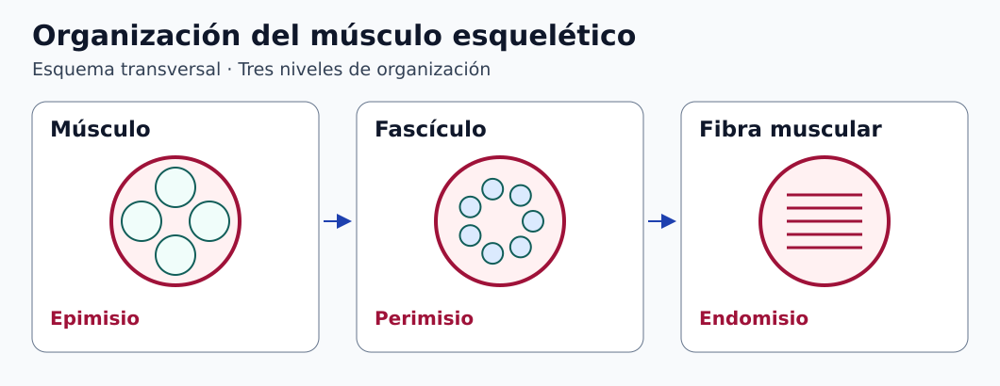

# Clase 02 · Tejido muscular, acciones y propiocepción

**Asignatura:** Biomecatrónica  
**Docente:** David Cortez Saravia  
**Fecha:** 10 de noviembre de 2026

[Ver la clase anterior](../clase-01-introduccion/README.md)

En esta sesión se repasaron los tipos de huesos y articulaciones, se retomó la propiocepción y se introdujo el tejido muscular. La clasificación por **tipo de tejido**, la **acción anatómica** y el **papel en una tarea** responden a preguntas diferentes.

## Del tejido a la acción

| Tipo | Rasgo | Ejemplo |
| --- | --- | --- |
| Esquelético | Estriado. Participa en el movimiento y la estabilidad corporal. | Bíceps braquial |
| Cardíaco | Estriado. Forma el tejido contráctil del corazón. | Miocardio |
| Liso | Sin estriación visible. Participa en el funcionamiento de órganos y vasos. | Pared intestinal |

En el músculo esquelético, varias fibras forman un fascículo y varios fascículos se organizan dentro del músculo. El **endomisio** rodea cada fibra, el **perimisio** cada fascículo y el **epimisio** el músculo. Esta organización contribuye a transmitir la fuerza hacia las inserciones. [1, 2]



*Figura 1. Organización del músculo esquelético. [Descripción en texto](figuras/DESCRIPCIONES.md) · [Créditos](figuras/CREDITOS.md).*

## Función en una tarea y movimiento de la articulación

| Término | Qué describe |
| --- | --- |
| Agonista | Contribución principal a la acción estudiada. |
| Antagonista | Acción opuesta. Puede participar en el frenado o la estabilidad. |
| Sinergista | Asistencia o control de movimientos asociados. |
| Fijador | Estabilización de una parte que sirve de apoyo a la acción. |

En una flexión de codo contra una carga, el braquial y el bíceps braquial pueden contribuir al momento flexor. Durante una bajada controlada, los flexores pueden seguir activos mientras se alargan. **Flexión y extensión describen el movimiento de la articulación.** El acortamiento y el alargamiento describen cómo cambia la longitud muscular durante la acción. [3]

La abducción y la aducción describen, en ejemplos como el hombro o la cadera, movimientos de alejamiento y acercamiento a la línea media. Elevación y depresión describen acciones como subir y bajar la cintura escapular. En el antebrazo, pronación y supinación cambian la orientación de la mano. En el pie, inversión y eversión describen el giro de la planta hacia medial o lateral. La pronación y la supinación del pie se usan para describir movimientos combinados, por lo que conviene indicar el segmento y la convención. La dorsiflexión y la flexión plantar se estudian principalmente en la articulación talocrural. [4]

## Propiocepción y realimentación

La propiocepción informa sobre la posición y el movimiento corporal incluso sin visión. El sistema nervioso integra señales somatosensoriales, entre ellas las de receptores musculares y tendinosos. Una prótesis puede incorporar sensores para medir la posición de sus componentes. Devolver información perceptible a la persona requiere además diseñar un canal de realimentación y evaluar si transmite la información prevista.

**Ejercicio complementario.** Una fuerza de 20 N aplicada perpendicularmente a 0,25 m del eje del codo genera un momento externo de 5 N·m. Con un brazo de momento muscular ideal de 0,04 m, el equilibrio requeriría una fuerza muscular de 125 N. Se omiten el peso del segmento, otras fuerzas musculares y la aceleración.

```math
M=F_{\mathrm{ext}}d_\perp=20(0.25)=5\ \mathrm{N\,m},
\qquad
F_m=\frac{M}{r_m}=125\ \mathrm{N}.
```

## Para practicar

Elijan una acción de codo, hombro o tobillo. Identifiquen la articulación, dos músculos que participen y su papel en una tarea concreta. Dibujen el eje de movimiento y señalen qué cambia al controlar el regreso bajo carga. Consulten el atlas para verificar la ubicación de los músculos.

## Referencias

1. OpenStax. [Tipos de tejido muscular](https://openstax.org/books/anatomy-and-physiology-2e/pages/10-1-overview-of-muscle-tissues).
2. OpenStax. [Organización del músculo esquelético](https://openstax.org/books/anatomy-and-physiology-2e/pages/10-2-skeletal-muscle).
3. OpenStax. [Interacción muscular y sistemas de palancas](https://openstax.org/books/anatomy-and-physiology-2e/pages/11-1-interactions-of-skeletal-muscles-their-fascicle-arrangement-and-their-lever-systems).
4. OpenStax. [Movimientos anatómicos](https://openstax.org/books/anatomy-and-physiology-2e/pages/9-5-types-of-body-movements).
5. Universidad de Michigan. [Atlas y tablas de anatomía BlueLink](https://sites.google.com/a/umich.edu/bluelink/resources/bluelink-anatomy-tables).

[Volver a Biomecatrónica](../../README.md) · [Volver al portafolio](../../../../README.md)
