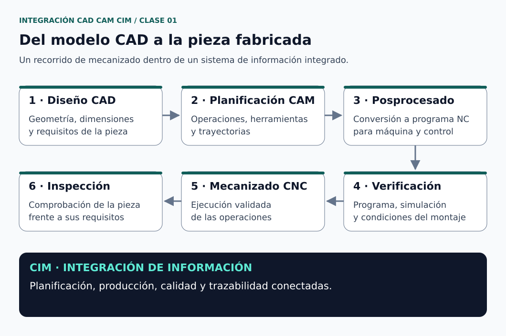
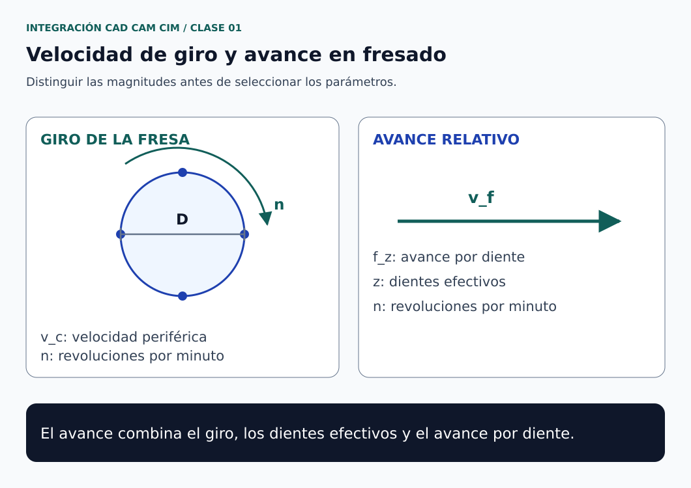

# Clase 01 · Del diseño CAD a la fabricación CNC

**Asignatura:** Integración CAD CAM CIM  
**Docente:** David Cortez Saravia  
**Fecha de referencia:** 26 de octubre de 2026  
**Modalidad:** virtual

## El punto de partida

Una pieza puede verse bien en pantalla y, aun así, resultar difícil de fabricar. Por eso, en esta asignatura vamos a relacionar las decisiones de diseño con el proceso que permitirá convertirlas en una pieza real.

La primera sesión presentó la organización del curso, las herramientas de trabajo y la preparación para las certificaciones de SOLIDWORKS. También abrió la discusión sobre programación CNC, optimización del diseño y uso de inteligencia artificial.

## Propósito de la sesión

Reconocer la relación entre diseño y fabricación, organizar el acceso a las herramientas del curso y comprender por qué el criterio del ingeniero sigue siendo necesario al utilizar software CAD/CAM o asistentes de IA.

## CAD, CAM y CIM: tres niveles relacionados

| Concepto | Pregunta que ayuda a responder | Resultado o información asociada |
| --- | --- | --- |
| CAD — diseño asistido por computador | ¿Qué pieza necesitamos y cómo se define? | Modelo geométrico, dimensiones y planos |
| CAM — manufactura asistida por computador | ¿Cómo se va a fabricar? | Operaciones, herramientas, trayectorias y parámetros |
| CIM — manufactura integrada por computador | ¿Cómo se conectan el diseño, la planificación y la producción? | Intercambio y coordinación de información entre áreas y equipos |

CAD y CAM conectan el modelo con la preparación de la fabricación. CIM amplía esa integración hacia el sistema productivo y sus datos. El diagrama siguiente resume un recorrido de mecanizado; no representa todos los procesos posibles de manufactura. [1, 2]

*Figura 1. Del modelo a la pieza y al intercambio de información de fabricación. [Créditos](figuras/CREDITOS.md) · [Descripción en texto](figuras/DESCRIPCIONES.md#figura-1).*

### El papel del posprocesador

El sistema CAM calcula trayectorias. El posprocesador las convierte en instrucciones NC según la máquina y su control. La configuración debe corresponder al equipo utilizado; no todos los controles aceptan exactamente la misma sintaxis. [3]

En el curso se utilizará FANUC como referencia de programación. Para trabajar sobre una máquina concreta habrá que comprobar su manual, las funciones disponibles y la configuración del posprocesador. Compartir instrucciones G y M no implica que distintos controles sean idénticos ni que uno derive necesariamente de otro.

### Por qué estudiar código G aunque exista la IA

Comprender el programa permite revisar unidades, referencias, desplazamientos, herramientas y condiciones de corte. Una respuesta coherente en apariencia puede apoyarse en datos que no corresponden al montaje o a la máquina.

La IA puede apoyar la explicación y la preparación de alternativas. La comprobación del programa, la simulación y la validación del montaje siguen formando parte del trabajo técnico. Esta entrada no incluye código listo para ejecutar en una máquina.

## Herramientas de trabajo

**SOLIDWORKS** será la herramienta principal de modelado presentada para el curso. El acceso institucional y el procedimiento de instalación se gestionan mediante las instrucciones del aula virtual.

**Onshape** se presentó como alternativa de CAD en la nube. Es importante elegir el plan adecuado: el plan Free está destinado a uso no comercial y a documentos públicos. El plan educativo tiene condiciones propias para estudiantes de instituciones acreditadas; no debe confundirse con el plan Free. [4, 5]

| Recurso | Para qué utilizarlo |
| --- | --- |
| [Onshape Free: condiciones oficiales](https://www.onshape.com/en/products/free) | Revisar el alcance del plan y la visibilidad de los diseños |
| [Onshape Student: condiciones de la suscripción](https://cad.onshape.com/help/Content/Plans/managing_your_onshape_student_subscription.htm) | Comprobar la opción educativa |
| [Onshape Learning Center](https://learn.onshape.com/) | Consultar formación y ejercicios de la plataforma |

## Certificaciones de SOLIDWORKS

Las certificaciones CSWA y CSWP se presentaron como referentes de competencia en diseño. Sus requisitos son diferentes y deben consultarse en la ficha del examen que se vaya a rendir.

| Certificación | Información publicada por SOLIDWORKS |
| --- | --- |
| [CSWA — Design Associate](https://www.solidworks.com/certifications/cswa-design-associate) | Duración de 3 horas y calificación mínima del 70 % |
| [CSWP — Design Professional](https://www.solidworks.com/certifications/solidworks-design-professional) | Tres segmentos, con un total de 3 horas y 20 minutos; cada segmento tiene su propio umbral de aprobación |

La política publicada establece una espera mínima de 14 días entre intentos de CSWA y entre intentos de un mismo segmento de CSWP. Cada intento requiere el crédito de examen correspondiente. Las condiciones de cobertura institucional y su equivalencia con la calificación de la asignatura se consultan en AVAC. [6, 7]

Datos de las fichas oficiales consultados el 27 de octubre de 2026.

## Diseño y optimización

La sesión introdujo la optimización topológica y el diseño asistido por IA como temas de discusión. Una optimización parte de objetivos, cargas, restricciones y condiciones de fabricación; una geometría de menor masa no garantiza por sí sola un comportamiento estructural adecuado. SOLIDWORKS describe los estudios topológicos como una exploración de diseños sujetos a objetivos y restricciones. [8]

Para analizar una propuesta conviene preguntar: ¿qué se optimiza?, ¿con qué cargas y apoyos?, ¿cómo se comprueba el comportamiento de la pieza? y ¿cómo se fabricaría?

## Fundamento de mecanizado complementario

Antes de programar movimientos, necesitamos distinguir la velocidad de corte de la velocidad de giro y del avance. El siguiente desarrollo amplía los temas de la sesión con un ejercicio de fresado.

### Velocidad de corte y velocidad de giro

Para un diámetro de corte efectivo $D$ expresado en milímetros: [9]

$$
v_c=\frac{\pi D n}{1000},
\qquad
n=\frac{1000v_c}{\pi D}
$$

La primera relación expresa la distancia recorrida por el filo en una vuelta, multiplicada por las vueltas por minuto. El factor 1000 convierte milímetros en metros.

### Avance de la herramienta respecto a la pieza

$$
v_f=f_z\,z\,n
$$

En esta relación, $z$ es el número efectivo de dientes utilizado para el cálculo del avance, no la cantidad de filos que toca simultáneamente la pieza en cada instante. Para el ejemplo se considera una fresa convencional con cuatro filos equivalentes. [9]

| Símbolo | Magnitud | Unidad utilizada |
| --- | --- | --- |
| $v_c$ | Velocidad de corte periférica | m/min |
| $D$ | Diámetro efectivo de corte | mm |
| $n$ | Velocidad de giro del husillo | rev/min |
| $f_z$ | Avance por diente | mm/diente |
| $z$ | Número efectivo de dientes | conteo de dientes |
| $v_f$ | Velocidad de avance relativa | mm/min |

En herramientas esféricas o con geometrías que cambian el diámetro efectivo, no siempre corresponde utilizar el diámetro nominal de la herramienta. [9]

*Figura 2. Magnitudes utilizadas para calcular giro y avance en fresado. [Créditos y fuente](figuras/CREDITOS.md) · [Descripción en texto](figuras/DESCRIPCIONES.md#figura-2).*

### Ejercicio resuelto

**Valores elegidos para practicar el cálculo, no recomendaciones de corte para un material o máquina:**

| Dato | Valor |
| --- | --- |
| Diámetro efectivo, $D$ | 10.0 mm |
| Velocidad de corte adoptada, $v_c$ | 100 m/min |
| Dientes efectivos, $z$ | 4 |
| Avance por diente adoptado, $f_z$ | 0.050 mm/diente |

Calculamos el giro:

$$
n=\frac{1000(100)}{\pi(10.0)}
=3183.10\ \mathrm{rev/min}
$$

Después calculamos el avance:

$$
v_f=(0.050)(4)(3183.10)
=636.62\ \mathrm{mm/min}
$$

Si para el ejercicio seleccionamos $n=3200\ \mathrm{rev/min}$, el avance que conserva $f_z$ es:

$$
v_f=(0.050)(4)(3200)=640\ \mathrm{mm/min}
$$

La velocidad de corte resultante también cambia:

$$
v_c=\frac{\pi(10.0)(3200)}{1000}
=100.53\ \mathrm{m/min}
$$

**Interpretación.** Giro y avance no se eligen de forma independiente si buscamos conservar el avance por diente. Si se cambia el giro, hay que revisar el avance.

En una aplicación real, los valores iniciales se seleccionan con las recomendaciones del fabricante para el material, la herramienta y la operación. También intervienen la profundidad y el ancho de corte, la sujeción, la refrigeración y las capacidades de la máquina. Los resultados anteriores son cálculos nominales del ejemplo, no mediciones de un ensayo.

### Pregunta para continuar

Si mantenemos $v_c=100\ \mathrm{m/min}$ y aumentamos el diámetro a 20.0 mm, ¿qué ocurre con el giro?

$$
n=\frac{1000(100)}{\pi(20.0)}
=1591.55\ \mathrm{rev/min}
$$

Al duplicar el diámetro, el giro necesario se reduce a la mitad para conservar la velocidad de corte. Si también mantenemos $f_z$ y $z$, el avance se reduce en la misma proporción.

## Continuidad del trabajo

El resumen presentado aquí organiza el inicio del curso y las herramientas que utilizaremos. Para continuar:

- Completar el registro institucional para la gestión de licencias y certificación.
- Revisar las actividades de introducción, seguridad de laboratorios y Código de Ética en AVAC.
- Consultar el material asignado para el foro sobre optimización y diseño asistido por IA.
- Preparar el acceso a SOLIDWORKS para la siguiente sesión práctica.

Las instrucciones, las fechas de entrega y el sistema de evaluación se mantienen en el aula virtual.

## Referencias de apoyo

Fuentes consultadas el 27 de octubre de 2026 para complementar y revisar los conceptos. Las fichas de software y certificación pueden actualizarse.

1. Autodesk. [CAD/CAM: diseño y manufactura asistidos por computador](https://www.autodesk.com/sg/solutions/cad-cam).
2. Siemens. [Digital manufacturing](https://www.siemens.com/en-us/technology/digital-manufacturing/).
3. Autodesk Support. [How to export G-code / NC code from Fusion](https://www.autodesk.com/support/technical/article/caas/sfdcarticles/sfdcarticles/Does-Fusion-360-Write-G-code.html).
4. Onshape. [Free Plan](https://www.onshape.com/en/products/free).
5. Onshape Help. [Student Subscription](https://cad.onshape.com/help/Content/Plans/managing_your_onshape_student_subscription.htm).
6. SOLIDWORKS. [Design Associate — CSWA](https://www.solidworks.com/certifications/cswa-design-associate).
7. SOLIDWORKS. [Design Professional — CSWP](https://www.solidworks.com/certifications/solidworks-design-professional).
8. SOLIDWORKS. [Topology Optimization Software & Modeling Tools](https://www.solidworks.com/media/topology-optimization).
9. Sandvik Coromant. [Milling formulas and definitions](https://www.sandvik.coromant.com/en-gb/knowledge/machining-formulas-definitions/milling-formulas-definitions).

---

[Volver a Integración CAD CAM CIM](../../README.md) · [Ver asignaturas](../../../README.md) · [Volver al portafolio](../../../../README.md)
