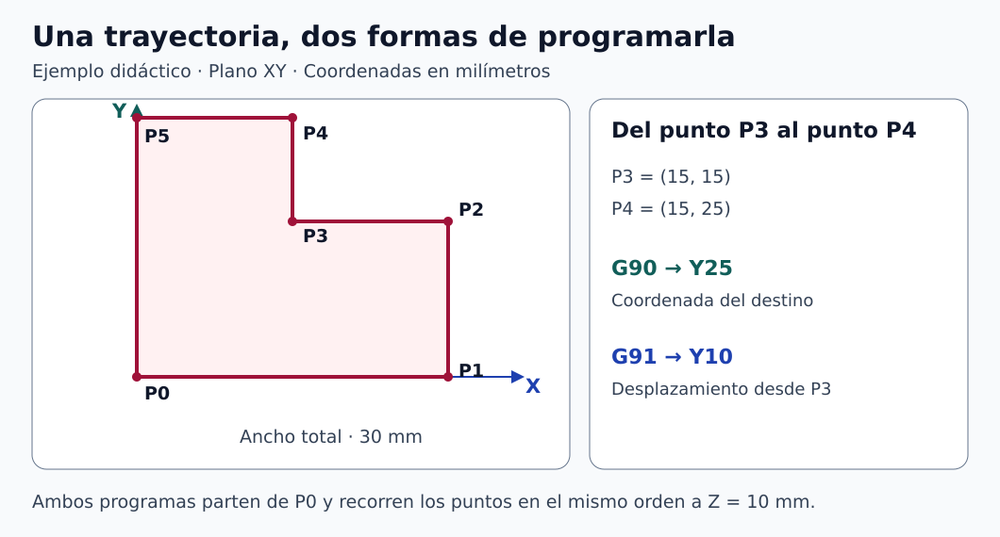
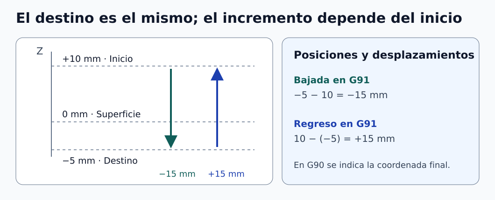

# Clase 02 · Coordenadas absolutas e incrementales en CNC

**Asignatura:** Integración CAD CAM CIM  
**Docente:** David Cortez Saravia  
**Fecha:** 6 de noviembre de 2026

[Clase anterior · Del diseño CAD a la fabricación CNC](../clase-01-introduccion/README.md)

La sesión se centró en programar una trayectoria usando coordenadas absolutas y después incrementales. Se revisaron los estados del control, la diferencia entre cero máquina y cero pieza, y la visualización del recorrido en NC Viewer. Al final se introdujeron los documentos y los croquis de SolidWorks.

## Leer un bloque de programa

En la programación de fresado utilizada como referencia, un bloque combina palabras que indican una operación o un parámetro.

| Dirección | Qué expresa | Ejemplo |
| --- | --- | --- |
| G | Funciones preparatorias, modos y movimientos | G90, G91, G01 |
| M | Funciones auxiliares definidas por el control | M03, M05, M30 |
| T | Selección de herramienta | T01 |
| S | Valor asociado al giro del husillo según el modo activo | S2000 |
| F | Avance según el modo activo | F300 con G94 representa 300 mm/min si están seleccionados milímetros |

Revisen la sintaxis de cada palabra y los espacios entre ellas. Por ejemplo, \`G01 X30 Y15\` permite distinguir el movimiento de sus coordenadas. Conserven el código y su valor unidos, como en \`T01\`. La aceptación de formatos y las funciones disponibles dependen del control. En los ejemplos de esta clase se usa una sintaxis habitual de fresado compatible con la referencia de Haas. [1, 2]

## Qué cambia entre G90 y G91

Con **G90**, las coordenadas indican posiciones respecto al sistema de trabajo activo. Con **G91**, indican desplazamientos desde la posición actual. Son modos que permanecen activos hasta seleccionar el otro. G91 no modifica por sí mismo el corrector del cero pieza. [1]

| Posición actual en X | Orden | Posición final en X |
| --- | --- | --- |
| 15 mm | G90 X30 | 30 mm |
| 15 mm | G91 X30 | 45 mm |
| 15 mm | G91 X-15 | 0 mm |

Para convertir una lista de posiciones absolutas en incrementos, resten dos posiciones consecutivas. Para recuperar la posición final, acumulen los incrementos desde una posición inicial conocida.

```math
\Delta\mathbf p_i=\mathbf p_i-\mathbf p_{i-1},
\qquad
\mathbf p_i=\mathbf p_0+\sum_{k=1}^{i}\Delta\mathbf p_k.
```

El signo indica el sentido sobre el eje programado. Un movimiento que regresa hacia el origen puede tener signo positivo o negativo según dónde se encuentre la herramienta. Escriban primero las posiciones y después calculen la diferencia.

## Ejercicio complementario · Un perfil escalonado

El siguiente contorno de 30 × 25 mm sirve para practicar la conversión. Sus puntos se definen aquí como ejemplo didáctico. La trayectoria se visualiza a Z = 10 mm, sin representar una operación de corte ni una compensación por radio.



*Figura 1. Puntos del contorno didáctico. [Descripción en texto](figuras/DESCRIPCIONES.md#figura-1) · [Créditos](figuras/CREDITOS.md).*

| Destino | X absoluto (mm) | Y absoluto (mm) | ΔX (mm) | ΔY (mm) |
| --- | ---: | ---: | ---: | ---: |
| P0 · Inicio | 0 | 0 | — | — |
| P1 | 30 | 0 | +30 | 0 |
| P2 | 30 | 15 | 0 | +15 |
| P3 | 15 | 15 | −15 | 0 |
| P4 | 15 | 25 | 0 | +10 |
| P5 | 0 | 25 | −15 | 0 |
| P0 · Cierre | 0 | 0 | 0 | −25 |

### Versión absoluta

```gcode
(EJEMPLO DIDACTICO - SOLO VISUALIZACION DE TRAYECTORIA)
(SIN DEFINICION DE HERRAMIENTA HUSILLO NI MONTAJE)
G21 G17 G90 G94
G00 Z10
G00 X0 Y0
G01 X30 Y0 F300
Y15
X15
Y25
X0
Y0
M30
```

### Versión incremental

```gcode
(EJEMPLO DIDACTICO - SOLO VISUALIZACION DE TRAYECTORIA)
(SIN DEFINICION DE HERRAMIENTA HUSILLO NI MONTAJE)
G21 G17 G90 G94
G00 Z10
G00 X0 Y0
G91
G01 X30 Y0 F300
Y15
X-15
Y10
X-15
Y-25
G90
M30
```

Descarguen los archivos para comparar sus recorridos en el visualizador.

- [Perfil en G90](codigo/perfil-g90.nc)
- [Perfil en G91](codigo/perfil-g91.nc)

Ambos fijan una posición inicial con G90. En la segunda versión se activa G91 para recorrer el contorno y se restablece G90 al terminar. F300 se eligió para el ejemplo de visualización. Para fabricar una pieza se requiere preparar el programa según la máquina, la herramienta, el material y el montaje.

### Comprobaciones del recorrido

La suma de los incrementos de X y de Y es cero porque el perfil regresa al inicio. Además, cada posición intermedia debe coincidir en ambos programas. El recorrido plano indicado tiene una longitud de 110 mm. Con avance constante de 300 mm/min, el tiempo ideal de esos seis segmentos sería 22 s. Este cálculo excluye posicionamiento inicial, aceleraciones y otros tiempos del proceso.

```math
L=30+15+15+10+15+25=110\ \mathrm{mm},
\qquad
t_{\mathrm{ideal}}=\frac{110}{300}\ \mathrm{min}
=22\ \mathrm{s}.
```

## Entender el movimiento en Z

Supongan que la superficie está en Z = 0, el punto inicial en Z = +10 mm y el destino en Z = −5 mm. En modo absoluto, la coordenada de destino es −5. En incremental, el desplazamiento necesario es −15. Para regresar desde −5 hasta +10, el incremento es +15.

```math
\Delta Z_{\mathrm{bajada}}=-5-10=-15\ \mathrm{mm},
\qquad
\Delta Z_{\mathrm{subida}}=10-(-5)=+15\ \mathrm{mm}.
```



*Figura 2. Coordenada de destino y desplazamiento vertical. [Descripción en texto](figuras/DESCRIPCIONES.md#figura-2) · [Créditos](figuras/CREDITOS.md).*

El ejemplo solo establece posiciones. Que el destino coincida con la cara inferior de una placa de 5 mm no garantiza que un taladro haya completado un agujero pasante. Ese caso requiere considerar la geometría de la punta y el montaje.

## Cero máquina, cero pieza y estados iniciales

El **cero máquina** es una referencia de la máquina. El **cero pieza** se establece para programar el trabajo y se relaciona con aquella mediante correctores. En el control de referencia, G54 selecciona uno de esos sistemas de trabajo. [2]

Durante la clase se revisó el encabezado \`G90 G21 G17 G40 G49 G69 G80\`. Cada palabra tiene una función que conviene interpretar antes de reutilizarla. [2]

| Código | Función en el control de referencia |
| --- | --- |
| G90 | Seleccionar posicionamiento absoluto |
| G21 | Seleccionar milímetros |
| G17 | Seleccionar el plano XY |
| G40 | Cancelar compensación de radio de herramienta |
| G49 | Cancelar compensación de longitud |
| G69 | Cancelar la rotación de coordenadas activada mediante G68 |
| G80 | Cancelar ciclos fijos |

El encabezado se adapta a los estados que se quieren establecer, las opciones y el procedimiento de la máquina. G69 se refiere a una rotación de coordenadas. Antes de usar este bloque en el laboratorio, comprueben su correspondencia con el manual del control.

### Interpretar G28

En el control Haas consultado, G28 devuelve los ejes indicados al cero máquina pasando por un punto intermedio cuando se especifica. El modo G90 o G91 afecta la interpretación de ese punto. En \`G91 G28 Z0\`, el incremento intermedio de Z es cero. G91 sigue activo después de ese bloque hasta seleccionar G90. [3]

Antes de programar un retorno, revisen la posición inicial, los ejes que se moverán y la trayectoria respecto a la pieza y las sujeciones. La secuencia debe corresponder a la máquina y al procedimiento de operación.

## Revisar en NC Viewer y preparar el trabajo CAD

En [NC Viewer](https://ncviewer.com/) pueden cargar el texto del programa, pulsar **Plot** y revisar el recorrido y las coordenadas. El sitio permite elegir una orientación de visualización **Z-Up** o **Y-Up**. Esa elección cambia la presentación de la escena. [4]

Para la práctica, anoten la posición después de cada bloque antes de graficar. Después comparen ambos archivos y comprueben los signos, el cierre y la altura Z. La comprobación de una trayectoria en el visualizador debe complementarse con la revisión de los correctores, las herramientas y el montaje antes de ejecutar un programa en máquina.

En SolidWorks se introdujeron los documentos de **pieza**, **ensamble** y **dibujo**. Para el trabajo de croquis:

1. Seleccionen un plano y definan dónde estará el origen del diseño.
2. Construyan la geometría y añadan relaciones, como horizontalidad, verticalidad, coincidencia o colinealidad.
3. Apliquen las cotas que expresan la intención de diseño y revisen el estado del croquis.
4. Comprueben el perfil y la operación de extrusión.

Como criterio de trabajo del curso, se busca un croquis completamente definido antes de continuar. En la configuración habitual, el azul indica geometría insuficientemente definida y el negro geometría definida. Revisen también el estado que muestra la interfaz. SolidWorks permite crear operaciones con croquis que aún tienen grados de libertad. [5]

La cota se elige según lo que se desea controlar. Una longitud de segmento puede seleccionarse sobre la línea. Una distancia entre puntos puede definirse seleccionando los dos extremos o vértices pertinentes. Comprueben la vista previa y si se está imponiendo una distancia horizontal, vertical o alineada. [6]

La disponibilidad de SolidWorks CAM se debe confirmar en la instalación y licencia utilizadas por el curso. La documentación del fabricante distingue CAM Standard y Professional y sus condiciones de acceso. [7]

## Actividad de estudio

Comparen los dos programas del contorno y completen una tabla de posiciones después de cada bloque. Comprueben el cierre y expliquen por qué el segundo tramo vertical usa Y10 en G91 y Y25 en G90.

Después creen el perfil en un croquis de SolidWorks, usen el origen como referencia y apliquen cotas y relaciones hasta definirlo. Si realizan la extrusión de práctica, utilicen 5 mm de espesor. Conserven los dos archivos NC y el modelo para revisar el trabajo. Las condiciones de evaluación y entrega se consultan en AVAC.

## Referencias de apoyo

Fuentes consultadas el 7 de noviembre de 2026. Los ejemplos CNC se contrastan con documentación de fresadoras Haas. Para otro control debe verificarse la equivalencia.

1. Haas Automation. [G90 y G91](https://haascnc.com/service/codes-settings.type=gcode.machine=mill.value=G91.html).
2. Haas Automation. [Códigos G de fresadora](https://haascnc.com/service/online-operator-s-manuals/mill-operator-s-manual/mill---g-codes.html).
3. Haas Automation. [G28 y retorno al cero máquina](https://haascnc.com/service/codes-settings.type=gcode.machine=mill.value=G28.html).
4. Toolpath Labs. [NC Viewer](https://ncviewer.com/).
5. Dassault Systèmes. [Sketch Status Conventions](https://help.solidworks.com/2025/English/SolidWorks/sldworks/c_Sketch_Status_Conventions.htm).
6. Dassault Systèmes. [Creating Dimensions Between Two Points](https://help.solidworks.com/2026/english/SolidWorks/sldworks/t_Creating_Dimensions_Between_Two_Points.htm).
7. Dassault Systèmes. [SOLIDWORKS CAM](https://help.solidworks.com/2026/English/WhatsNew/c_wn_cam.htm).

---

[Volver a Integración CAD CAM CIM](../../README.md) · [Volver al portafolio](../../../../README.md)
