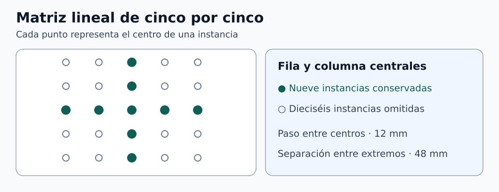

# Clase 03 · Croquis, simetría y matrices lineales en SolidWorks

**Asignatura:** Integración CAD CAM CIM  
**Docente:** David Cortez Saravia  
**Fecha:** 10 de noviembre de 2026

[Ver la clase anterior](../clase-02-coordenadas-g90-g91/README.md)

En esta sesión se trabajó el croquis 2D en SolidWorks. Las relaciones, las cotas, la simetría y la matriz lineal permiten que una modificación de diseño se propague de forma controlada.

## Elegir el plano y definir el croquis

Seleccionen el plano según la geometría y la dirección de extrusión prevista. Para fabricar la pieza, comprueben también la orientación del sistema de coordenadas del montaje. El nombre de una vista CAD por sí solo no determina el plano de mecanizado. En el ejemplo de práctica, el origen sirve para fijar una referencia geométrica del croquis.

| Relación | Cuándo usarla |
| --- | --- |
| Horizontal o vertical | Orientar un segmento respecto a los ejes del croquis. |
| Coincidente | Unir un punto a otro punto o a una entidad compatible. |
| Colineal | Alinear segmentos sobre una misma recta. |
| Igual | Conservar una longitud o radio común en entidades compatibles. |

Una cota **conductora** impone un valor. Una cota **conducida** muestra una medida resultante. Si dos lados ya son iguales y uno está acotado, una segunda cota conductora de longitud puede ser redundante. Una cota conducida puede servir para comprobar esa longitud. Seleccionen líneas o puntos según la magnitud que quieran controlar. Revisen la vista previa y el estado del croquis. [1, 2]

Con una ventana de izquierda a derecha se seleccionan las entidades contenidas por completo. La selección de cruce, de derecha a izquierda, incluye las entidades que intersectan la ventana. Antes de añadir una relación, comprueben las entidades resaltadas y el resultado que se propone.

## Simetría y matriz lineal

Para reflejar entidades, definan una línea de referencia y seleccionen la geometría que desean reflejar. Para una matriz lineal, definan la entidad semilla, las direcciones, el paso y el número de instancias. En dos direcciones se obtiene una cuadrícula. Para dejar una cruz centrada, pueden omitir las posiciones que no pertenezcan a la fila ni a la columna centrales. [3, 4]



*Figura 1. Matriz lineal de cinco por cinco. [Descripción en texto](figuras/DESCRIPCIONES.md) · [Créditos](figuras/CREDITOS.md).*

**Ejemplo complementario.** Una matriz de cinco por cinco, con paso de 12 mm en cada dirección, tiene 25 posiciones. La distancia entre centros extremos en cada dirección es de 48 mm. Una cruz que conserva la fila y la columna centrales tiene nueve posiciones, pues el centro se cuenta una vez.

```math
L=(5-1)(12\ \mathrm{mm})=48\ \mathrm{mm},
\qquad N_{\mathrm{cruz}}=5+5-1=9.
```

## Para practicar

Repitan la cruz con círculos de diámetro 4 mm y paso 12 mm. Verifiquen el número de instancias y la separación entre centros extremos. En un croquis separado, reflejen una entidad respecto a una línea de construcción y comprueben que la copia responde a un cambio en la geometría original. Para la **Práctica 1**, usen el plano y las condiciones de entrega de AVAC.

## Referencias

1. Dassault Systèmes. [Cotas conducidas](https://help.solidworks.com/2026/english/SolidWorks/sldworks/t_Inserting_Reference_Dimensions.htm).
2. Dassault Systèmes. [Cotas entre dos puntos](https://help.solidworks.com/2026/english/SolidWorks/sldworks/t_Creating_Dimensions_Between_Two_Points.htm).
3. Dassault Systèmes. [Simetría de entidades](https://help.solidworks.com/2026/English/SolidWorks/sldworks/c_Mirror_Entities.htm).
4. Dassault Systèmes. [Matrices lineales de croquis](https://help.solidworks.com/2024/english/solidworks/sldworks/t_Creating_Linear_Sketch_Patterns.htm).

[Volver a Integración CAD CAM CIM](../../README.md) · [Volver al portafolio](../../../../README.md)
