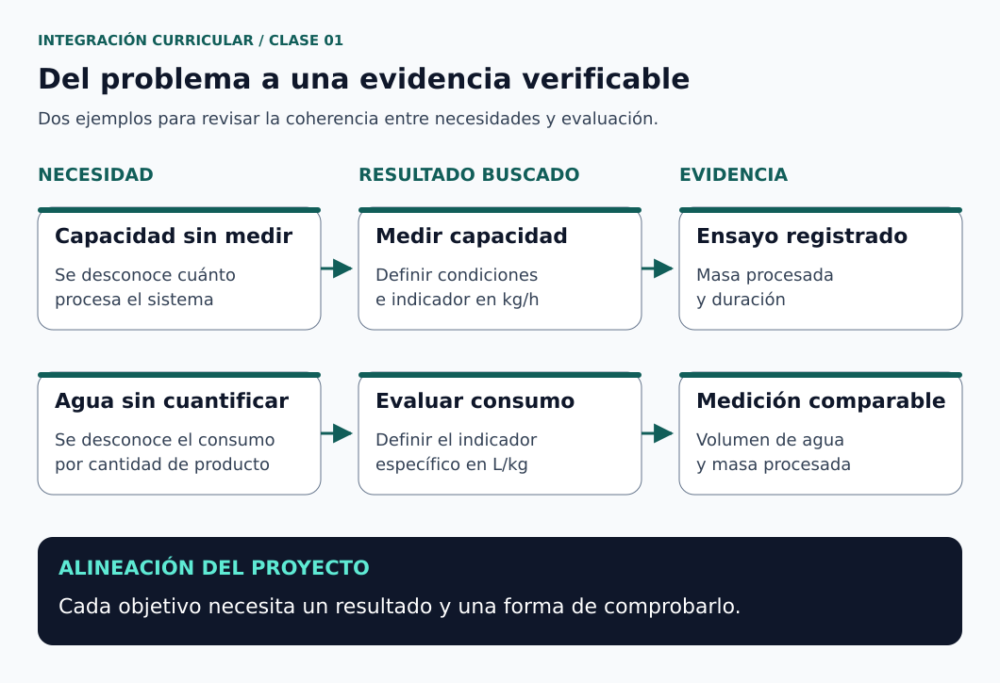
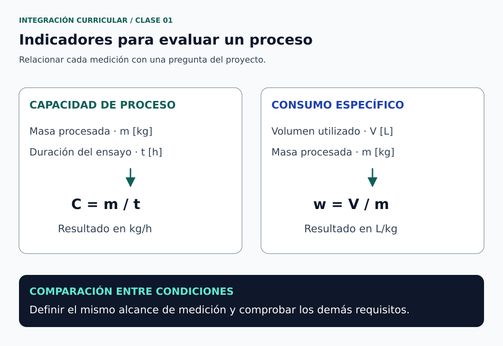

# Clase 01 · Del problema a los objetivos y la evidencia

**Asignatura:** Integración Curricular (Tesis)  
**Docente:** David Cortez Saravia  
**Fecha de referencia:** 29 de octubre de 2026  
**Modalidad:** virtual

## El punto de partida

Un proyecto de titulación necesita una relación clara entre lo que ocurre, lo que se propone hacer y la forma de comprobar el resultado. Si estos elementos se redactan por separado, es fácil terminar con un objetivo que no responde al problema o con una metodología que no genera la evidencia necesaria.

La sesión se centró en revisar avances, organizar las entregas y mejorar la coherencia entre problema, justificación y objetivos. También se trabajó la estructura del marco teórico, la secuencia metodológica y el manejo de figuras, tablas y referencias en LaTeX.

## Propósito de la sesión

Revisar la formulación del proyecto para que cada objetivo tenga un alcance definido, una relación con el problema y una forma de evaluación.

## Problema, justificación y objetivos

| Elemento | Pregunta que debe ayudar a responder | Qué conviene evitar |
| --- | --- | --- |
| Problema | ¿Qué situación concreta requiere investigación o desarrollo? | Afirmaciones generales sin evidencia o un contexto distinto al del título |
| Justificación | ¿Por qué vale la pena atenderla y qué aportaría el proyecto? | Repetir el problema sin explicar la contribución |
| Objetivo general | ¿Qué resultado principal se busca alcanzar? | Promesas más amplias que el trabajo posible |
| Objetivos específicos | ¿Qué resultados parciales permiten alcanzar el objetivo general? | Listar tareas administrativas o actividades sin producto identificable |
| Metodología | ¿Cómo se obtendrán y comprobarán esos resultados? | Enumerar herramientas sin explicar para qué se utilizarán |

La justificación debe relacionarse con las necesidades descritas: si el problema incluye consumo de agua, la contribución debe explicar cómo se estudiará ese recurso. Una afirmación sobre higiene o calidad requiere sus propios indicadores; no se demuestra únicamente por reducir el consumo.

## Cómo redactar objetivos que se puedan evaluar

Un objetivo debe expresar una acción y un resultado reconocible. Puede precisar el método y la finalidad cuando ayuden a delimitarlo; no necesita repetir toda la metodología.

La posibilidad de evaluar un objetivo no siempre depende de un porcentaje. Un modelo, un diseño o un prototipo también pueden ser resultados verificables si se definen sus requisitos y los criterios de revisión.

Como apoyo de ingeniería, NASA recomienda requisitos claros y verificables, con un medio de comprobar su cumplimiento. Aquí utilizaremos ese criterio para conectar los objetivos con la evaluación del proyecto; no se trata de un formato institucional de tesis. [1]

### De una formulación amplia a una comprobable

| Formulación inicial | Pregunta de revisión | Redacción orientativa |
| --- | --- | --- |
| Diseñar considerando la capacidad de producción | ¿Qué capacidad, de qué producto y bajo qué condiciones? | Definir los requisitos de capacidad del proceso mediante la caracterización de la operación y sus restricciones |
| Optimizar el consumo de recursos | ¿Qué recurso y con qué indicador se comparará? | Evaluar el consumo específico de agua mediante ensayos comparativos con el proceso de referencia |
| Garantizar higiene y calidad | ¿Qué pruebas permitirían sostener esa afirmación? | Evaluar el indicador de limpieza definido para el alcance y el protocolo del proyecto |

Los ejemplos orientan la redacción; deben adaptarse al alcance real de cada trabajo.

**“Optimizar” no es un verbo incorrecto por sí mismo.** Si se utiliza, debe quedar claro qué se optimiza, qué variables se pueden modificar, cuáles son las restricciones y cómo se evaluará la solución. Si el trabajo solo compara una mejora concreta, conviene describir esa comparación directamente.

“Desarrollar” puede reunir diseño e implementación cuando ambos forman parte del alcance. No sustituye la necesidad de explicar qué se entregará y cómo se comprobará.

## Matriz de trazabilidad del proyecto

Una matriz de trazabilidad permite revisar si cada necesidad se conecta con un objetivo, un criterio y una evidencia. Las matrices de verificación de ingeniería relacionan requisitos identificados con sus métodos de comprobación; la siguiente organización es una adaptación didáctica para la asignatura. [2]



*Figura 1. Relación entre necesidad, objetivo y evidencia. [Créditos](figuras/CREDITOS.md) · [Descripción en texto](figuras/DESCRIPCIONES.md#figura-1).*

| Necesidad o problema | Resultado asociado al objetivo | Indicador o criterio | Evidencia prevista |
| --- | --- | --- | --- |
| La capacidad del proceso no está caracterizada | Caracterizar las condiciones de operación | Masa procesada por unidad de tiempo | Registro de masa, tiempos y condiciones de ensayo |
| El consumo de agua no está cuantificado | Evaluar el consumo específico | Volumen utilizado por masa procesada | Registros de volumen y masa con instrumentos identificados |
| Se propone un nuevo diseño | Desarrollar la solución dentro del alcance | Cumplimiento de requisitos geométricos y funcionales | Planos, modelo, revisión y pruebas pertinentes |
| Se espera una mejor limpieza | Evaluar el desempeño de limpieza | Indicador definido y justificado para ese propósito | Resultados del protocolo acordado con el tutor |

Una fila vacía en la columna de evidencia indica que falta definir cómo se comprobará el resultado. Un dato observado en un caso concreto no debe convertirse automáticamente en una exigencia universal para todos los proyectos.

## Método: del objetivo al procedimiento

Para cada objetivo, conviene especificar:

1. **Qué se estudiará:** sistema, producto, condiciones y límites del análisis.
2. **Qué se medirá o revisará:** variables, unidades e indicadores.
3. **Cómo se obtendrán los datos:** instrumentos, procedimiento y registro.
4. **Con qué se comparará:** requisito, referencia o condición inicial.
5. **Cómo se analizarán:** cálculos, comparación, variabilidad y limitaciones.

El marco teórico aporta conceptos y antecedentes para estas decisiones. La metodología explica cómo se aplicarán al proyecto. Un cronograma ubica las actividades en el tiempo, pero no reemplaza el procedimiento.

En términos de ingeniería, **verificar** permite comprobar requisitos, mientras que **validar** busca establecer si el producto responde a su uso y necesidades previstos. Un prototipo puede cumplir una dimensión especificada y todavía requerir una evaluación de utilidad en su contexto. [2, 3]

## Ejercicio complementario · Medir antes de afirmar una mejora

Este ejemplo usa un proceso piloto de lavado de fruta para practicar indicadores. **Todos los valores son didácticos; no corresponden a mediciones de estudiantes ni de una empresa.**

### Capacidad observada durante el ensayo

```math
C=\frac{m}{t}
```

$`C`$ es la capacidad media observada en kg/h, $`m`$ la masa procesada en kg y $`t`$ la duración en horas. Hay que definir qué incluye el intervalo: solo procesamiento efectivo o también paradas y preparación.

Si se procesan 120 kg en 30 min:

```math
t=\frac{30}{60}=0.50\ \mathrm{h},
\qquad
C=\frac{120}{0.50}=240\ \mathrm{kg/h}
```

Este cociente describe el ensayo. No establece por sí solo la capacidad nominal de diseño ni la producción sostenida de una jornada.

### Consumo específico de agua

```math
w=\frac{V}{m}
```

$`w`$ es el consumo específico en L/kg y $`V`$ el volumen de agua utilizado en litros. La masa debe corresponder al mismo período y al mismo límite del sistema que el volumen.



*Figura 2. Variables e indicadores para una comparación de proceso. [Créditos](figuras/CREDITOS.md) · [Descripción en texto](figuras/DESCRIPCIONES.md#figura-2).*

| Condición del ejemplo | Masa procesada | Agua utilizada | Consumo específico |
| --- | --- | --- | --- |
| Referencia | 120 kg | 120 L | 1.00 L/kg |
| Alternativa | 120 kg | 90 L | 0.75 L/kg |

### Reducción relativa del consumo específico

Para una referencia positiva $`w_0`$, la reducción relativa es:

```math
\delta_w=
\frac{w_0-w_1}{w_0}\times100\%
```

$`w_0`$ y $`w_1`$ son los consumos específicos de referencia y de la alternativa, respectivamente.

```math
\delta_w=
\frac{1.00-0.75}{1.00}\times100\%
=25\%
```

**Interpretación.** Los valores elegidos muestran un consumo específico un 25 % menor. No demuestran todavía mejor limpieza, menor carga microbiana ni significancia estadística. Para un estudio real habrá que repetir las mediciones con un protocolo y condiciones comparables, revisar su variabilidad y comprobar los demás requisitos.

### Para practicar

Antes de aceptar una conclusión de mejora, responde:

- ¿Las dos condiciones procesaron producto comparable y con el mismo alcance de operación?
- ¿Cómo se midió el volumen y qué incluye: lavado, enjuague, limpieza del equipo o reposición?
- ¿Qué criterio permite decidir si la limpieza es suficiente?
- ¿Qué factores podrían explicar una diferencia aparte del nuevo diseño?

Estas preguntas ayudan a convertir una cifra en una conclusión técnicamente defendible.

## Hipótesis y alcance del proyecto

La necesidad de una hipótesis depende de la pregunta, el diseño del estudio y el formato institucional aplicable. Un desarrollo tecnológico puede organizar su evaluación mediante requisitos y criterios de aceptación; si además plantea una hipótesis, debe definir cómo se contrastará.

La hipótesis y la justificación cumplen funciones diferentes. La primera formula una proposición que se evaluará; la segunda explica por qué se realiza el trabajo. La modalidad y los apartados exigidos deben confirmarse con el tutor y la documentación de AVAC.

## Citas, figuras y referencias en LaTeX

Las afirmaciones tomadas de otras fuentes deben tener una referencia identificable. También deben citarse los datos externos, las figuras reutilizadas y los métodos adoptados. No hace falta añadir una cita artificial a cada párrafo si este describe una decisión propia o un resultado del proyecto; debe quedar claro qué procede de la literatura y qué aporta el trabajo.

Para la asignatura se trabajará con referencias IEEE y un archivo bibliográfico .bib, conforme a las indicaciones del curso.

### Qué hace cada archivo

| Elemento | Función |
| --- | --- |
| Documento .tex | Contiene el texto y las llamadas de cita |
| Archivo .bib | Guarda los datos bibliográficos de las fuentes |
| Estilo bibliográfico | Define la presentación y el orden de la bibliografía |
| Clave de cita | Identifica una entrada del .bib desde el texto |

Con BibTeX, el estilo IEEEtran organiza las referencias en orden de citación. Guardar una entrada en el .bib no significa citarla automáticamente en el documento. [4, 5]

**Ejemplo de código LaTeX para una plantilla que utilice BibTeX:**

```latex
La matriz vincula cada requisito con su comprobación
\cite{nasa_matriz_verificacion}.

% Al final del documento, si la plantilla no lo incluye ya:
\bibliographystyle{IEEEtran}
\bibliography{referencias}
```

**Entrada correspondiente en referencias.bib:**

```bibtex
@misc{nasa_matriz_verificacion,
  author = {{NASA}},
  title = {Appendix D: Requirements Verification Matrix},
  howpublished = {\url{https://www.nasa.gov/reference/appendix-d-requirements-verification-matrix/}},
  note = {Consultado el 30 de octubre de 2026}
}
```

La plantilla debe cargar un paquete para gestionar URL, como url o hyperref. Si utiliza biblatex, su configuración es diferente: no se deben mezclar los dos mecanismos sin revisar la plantilla. La guía de Overleaf explica el flujo de BibTeX y la relación entre cita, archivo bibliográfico y estilo. [4]

Las figuras y tablas deben tener título o pie, unidades cuando correspondan, una etiqueta para referenciarlas y una explicación en el texto. Una ilustración tiene que aportar información al argumento, no servir únicamente como decoración.

## Recursos de consulta

| Recurso | Uso propuesto |
| --- | --- |
| [NASA: cómo redactar un buen requisito](https://www.nasa.gov/reference/appendix-c-how-to-write-a-good-requirement/) | Revisar claridad y posibilidad de comprobar criterios técnicos |
| [NASA: matriz de verificación](https://www.nasa.gov/reference/appendix-d-requirements-verification-matrix/) | Organizar requisitos, identificadores y comprobaciones |
| [NASA: validación del producto](https://www.nasa.gov/reference/5-4-product-validation/) | Distinguir cumplimiento técnico y respuesta a necesidades de uso |
| [Overleaf: gestión bibliográfica con BibTeX](https://www.overleaf.com/learn/latex/Bibliography_management_with_bibtex) | Revisar .bib, claves de cita y compilación de referencias |
| [IEEEtran: documentación de su autor, distribuida en CTAN](https://mirrors.ctan.org/macros/latex/contrib/IEEEtran/bibtex/IEEEtran_bst_HOWTO.pdf) | Consultar la configuración del estilo IEEEtran |

Las fuentes de ingeniería se emplean como apoyo metodológico. No sustituyen la rúbrica ni la normativa de titulación de la universidad.

## Continuidad del trabajo

El resumen presentado aquí organiza los criterios para revisar la primera parte del proyecto. Antes de la siguiente entrega:

- Comprobar que título, problema, justificación y objetivos se refieran al mismo sistema y contexto.
- Preparar una matriz que relacione cada objetivo con su resultado y evidencia.
- Confirmar los datos de tema, grupo y tutor en los registros institucionales.
- Revisar la carta de aceptación del tutor y las instrucciones de entrega.
- Verificar las claves de cita y los datos de las fuentes en el archivo .bib.
- Subir la versión o sección solicitada en la actividad correspondiente de AVAC.

Las fechas, la distribución de calificaciones y el alcance de cada revisión se consultan en AVAC.

## Referencias de apoyo

Fuentes consultadas el 30 de octubre de 2026 para complementar los criterios de la sesión.

1. NASA. [Appendix C: How to Write a Good Requirement](https://www.nasa.gov/reference/appendix-c-how-to-write-a-good-requirement/).
2. NASA. [Appendix D: Requirements Verification Matrix](https://www.nasa.gov/reference/appendix-d-requirements-verification-matrix/).
3. NASA. [5.4 Product Validation](https://www.nasa.gov/reference/5-4-product-validation/).
4. Overleaf. [Bibliography Management with BibTeX](https://www.overleaf.com/learn/latex/Bibliography_management_with_bibtex).
5. M. Shell. [How to Use the IEEEtran BibTeX Style](https://mirrors.ctan.org/macros/latex/contrib/IEEEtran/bibtex/IEEEtran_bst_HOWTO.pdf), documentación de IEEEtran distribuida en CTAN.

---

[Volver a Integración Curricular](../../README.md) · [Ver asignaturas](../../../README.md) · [Volver al portafolio](../../../../README.md)
