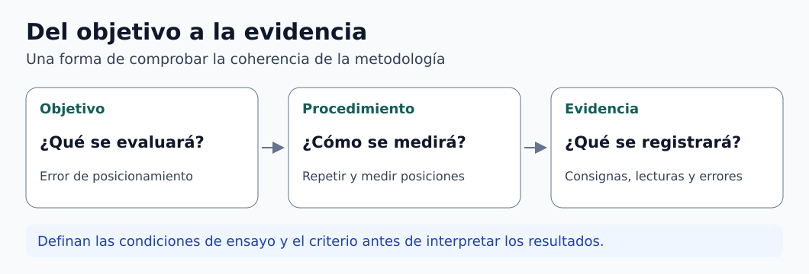

# Clase 02 · Del marco teórico a la metodología

**Asignatura:** Integración Curricular (Tesis)  
**Docente:** David Cortez Saravia  
**Fecha:** 5 de noviembre de 2026

[Clase anterior · Del problema a los objetivos y la evidencia](../clase-01-problema-objetivos/README.md) · [Guía de primera revisión](../../guias/guia-01-revision-anteproyecto/README.md)

La sesión se dedicó a revisar avances de anteproyectos. El trabajo consistió en precisar qué puede demostrar cada propuesta y conectar ese alcance con el marco teórico, la metodología y las pruebas previstas.

## Grabación de la clase

[Ingresar a AVAC con la cuenta institucional](https://avac.ups.edu.ec/). Abre el aula de la asignatura y busca la grabación por la fecha de la sesión, si está habilitada.

## Ajustar el alcance antes de escribir la metodología

Si el trabajo solo contempla una demostración en un entorno controlado, describan ese entorno y lo que efectivamente se comprobará allí. Mantengan el mismo alcance en el título, el problema, la justificación y los objetivos. Una prueba funcional del prototipo sustenta una conclusión sobre las condiciones probadas. Afirmaciones sobre desempeño en otros contextos requieren evidencia adicional.

Al revisar el problema, comprueben que las cifras y la población descrita corresponden al caso. En la justificación, expliquen por qué el proyecto responde a esa necesidad y qué aporte cabe esperar. Redacten los objetivos con un resultado reconocible. Por ejemplo, si el alcance incluye construir y probar un prototipo, identifiquen el producto y la prueba que permitirá evaluar su funcionamiento.

## Escribir un marco teórico que ayude a decidir

| Parte | Pregunta que debe responder |
| --- | --- |
| Contexto de aplicación | ¿Qué necesidad y qué condiciones delimitan el diseño? |
| Principios técnicos | ¿Qué conceptos permiten explicar el comportamiento del sistema? |
| Comparación de soluciones | ¿Qué alternativas existen y en qué difieren según criterios pertinentes? |
| Decisiones de diseño | ¿Qué evidencia justifica los componentes, métodos o variables escogidos? |

Una comparación técnica puede considerar grados de libertad, sensores, actuadores, prestaciones o costo, según la pregunta del proyecto. Identifiquen la fuente y las condiciones de cada dato. Un campo sin información puede quedar como «no reportado». Si los ensayos no son comparables, expliquen la diferencia antes de ordenar alternativas.

Usen figuras donde ayuden a explicar un principio, una arquitectura o una variable. Incluyan el pie, la fuente y la referencia en el texto. Prioricen bibliografía reciente para describir el estado del arte y conserven fuentes fundacionales cuando sustenten el método. Incluyan DOI cuando la fuente lo tenga y completen los datos bibliográficos que permitan localizarla.

## Convertir objetivos en procedimientos

*Figura 1. Relación entre objetivo, procedimiento y evidencia. [Descripción en texto](figuras/DESCRIPCIONES.md) · [Créditos](figuras/CREDITOS.md).*

En la metodología, usen un diagrama de flujo para introducir la secuencia del trabajo y luego expliquen cada paso. Si el sistema tiene decisiones, retroalimentación o condiciones de detención, señálenlas donde correspondan. Distingan el **flujo de desarrollo** (diseñar, construir e integrar) del **flujo de operación** (qué hace el sistema durante su uso).

Para cada prueba, definan el montaje, las condiciones, las variables y unidades, la forma de registrar datos y el criterio de evaluación. Si fijan un umbral, expliquen de dónde viene. La matriz que sigue adapta el principio de trazabilidad entre requisitos y métodos de comprobación. [1]

### Ejemplo didáctico · Dispositivo de posicionamiento de piezas

| Objetivo | Procedimiento | Evidencia |
| --- | --- | --- |
| Definir el diseño según el tamaño de las piezas y el recorrido requerido | Establecer las dimensiones, el intervalo de movimiento y las restricciones de montaje | Requisitos y planos revisados |
| Integrar un prototipo capaz de ejecutar el ciclo previsto | Montar componentes y registrar la secuencia de operación | Registro de integración y de las pruebas funcionales |
| Evaluar el error de posicionamiento bajo condiciones de banco definidas | Repetir consignas en puntos establecidos y comparar la posición medida con la referencia | Tabla de consignas, lecturas, error y dispersión |

El ejemplo es ilustrativo. El instrumento, el número de ciclos y los límites de aceptación deben justificarse para el alcance de cada proyecto. Una prueba que confirma la ejecución de un ciclo aporta evidencia funcional. La exactitud o la repetibilidad requieren mediciones que permitan evaluarlas.

## Para la siguiente revisión

1. Confirmen que el título, el problema y los objetivos describen el mismo alcance.
2. Incluyan una comparación técnica de antecedentes que sirva para justificar decisiones.
3. Incorporen el diagrama de flujo y expliquen cómo se ejecutará cada etapa.
4. Relacionen cada objetivo con una evidencia prevista y revisen el formato y las referencias.
5. Consulten en AVAC la actividad correspondiente y sus indicaciones de entrega.

## Referencia

1. NASA. [Appendix D · Requirements Verification Matrix](https://www.nasa.gov/reference/appendix-d-requirements-verification-matrix/). Referencia de ingeniería para vincular requisitos con métodos de comprobación.

[Volver a Integración Curricular](../../README.md) · [Volver al portafolio](../../../../README.md)
