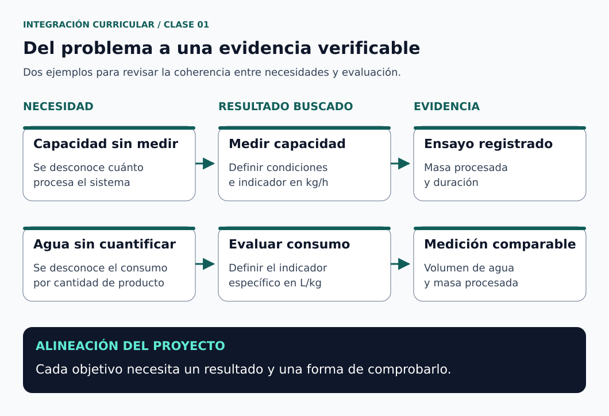

# Guía 01 · Cómo atender la primera revisión del anteproyecto

**Asignatura:** Integración Curricular (Tesis)  
**Docente:** David Cortez Saravia  
**Actualización:** 31 de octubre de 2026

[Volver a la asignatura](../../README.md) · [Revisar la clase sobre problema, objetivos y evidencia](../../clases/clase-01-problema-objetivos/README.md)

La primera revisión debe ayudar a que el proyecto tenga una dirección clara. Antes de ampliar el documento, conviene comprobar que el título, el problema, la justificación y los objetivos describen el mismo trabajo y que su alcance se puede cumplir.

Esta guía reúne criterios de trabajo para revisar esa coherencia. Las observaciones específicas de cada devolución se atienden sobre el documento correspondiente; las indicaciones de formato, entrega y evaluación se consultan en AVAC.

## 1. Comenzar por el alcance

Expliquen qué van a entregar: un diseño, un dispositivo, una plataforma, un modelo o una evaluación. Precisen también qué quedará fuera del trabajo. El título y el objetivo general deben reflejar ese compromiso.

No es equivalente estudiar un equipo existente, modificarlo o desarrollar uno nuevo. Si la contribución propuesta genera dudas sobre su pertinencia para la modalidad de titulación, consúltenla con el tutor y la coordinación correspondiente antes de continuar. El uso de un equipo comercial no invalida por sí mismo un trabajo: hay que explicar cuál es la contribución y cómo se evaluará.

| Pregunta | Qué debe quedar identificado |
| --- | --- |
| ¿Qué se propone? | Producto o resultado principal |
| ¿Para quién y en qué contexto? | Usuarios, sistema o proceso delimitados |
| ¿Qué se realizará realmente? | Diseño, fabricación, programación o evaluación previstos |
| ¿Qué se podrá demostrar? | Evidencia que estará disponible al terminar |
| ¿Qué no se incluye? | Límites del proyecto |

## 2. Redactar el problema desde el contexto hasta la necesidad concreta

Para esta asignatura, organicen la exposición de lo general a lo particular:

1. Presenten brevemente el contexto del tema.
2. Describan el contexto nacional, local o institucional que resulte pertinente.
3. Expliquen las necesidades concretas que atenderá el proyecto.
4. Relacionen esas necesidades con los resultados que después expresarán en los objetivos.

Incluyan cifras cuando ayuden a dimensionar el problema y exista una fuente adecuada. Verifiquen año, población, lugar, definición del indicador y relación con el tema. Un dato de otro sector o de otra población no sustenta automáticamente la necesidad del proyecto.

**Si todavía no tienen una cifra verificable, no la completen por aproximación.** Busquen la fuente o documenten la necesidad mediante evidencia pertinente. La estructura general–particular es una orientación de redacción del curso; no exige forzar estadísticas ni añadir un contexto nacional sin relación con el caso.

Cada necesidad importante debe quedar desarrollada con claridad. No se trata de repetir el objetivo en negativo, sino de explicar qué limitación existe, a quién afecta y qué consecuencias tiene dentro del alcance estudiado.

## 3. Hacer que la justificación explique el aporte

El problema describe la situación que se busca atender. La justificación explica por qué vale la pena hacerlo y qué aportaría el trabajo.

Relacionen sus argumentos con las necesidades ya presentadas. Si se propone facilitar una operación, expliquen qué dificultad se atenderá y cómo se evaluará la contribución. Eviten prometer reducción de costos, mayor seguridad, mejor aprendizaje o beneficios clínicos cuando el proyecto no contempla evidencia para sostenerlos.

Distingan entre **beneficio esperado** y **resultado demostrado**. En un anteproyecto se puede proponer una mejora; su magnitud y cumplimiento se determinarán mediante la evaluación prevista.

## 4. Revisar los objetivos sin cambiar su sentido innecesariamente

El objetivo general debe expresar el resultado principal y mantener el alcance del título. Utilicen «Desarrollar» cuando el trabajo incluya efectivamente las etapas necesarias para obtener la solución propuesta. Si el alcance es solo diseño o evaluación, el verbo debe corresponder a ese trabajo.

Los objetivos específicos deben producir resultados identificables y contribuir al objetivo general. Eviten reunir dos compromisos independientes en una frase si requieren procedimientos y evidencias distintos. Tampoco hace falta dividir cada actividad menor en un objetivo.

| Formulación demasiado amplia | Qué falta resolver |
| --- | --- |
| Mejorar el funcionamiento del sistema | Qué aspecto se evaluará y respecto de qué referencia |
| Optimizar el proceso | Variables de decisión, criterio de optimización y restricciones |
| Validar el dispositivo | Uso previsto, requisitos, procedimiento y criterios de aceptación |
| Investigar y diseñar y construir y evaluar | Jerarquía de resultados y alcance de cada etapa |

Un objetivo no necesita contener un porcentaje arbitrario para ser evaluable. Puede comprobarse mediante un diseño revisado, un prototipo y sus ensayos, un modelo contrastado o un análisis con criterios definidos. Como apoyo, la guía de requisitos de NASA recomienda claridad y posibilidad de verificación; su adaptación a los objetivos no sustituye la rúbrica del curso. [1]

## 5. Comprobar la relación entre necesidad, objetivo y evidencia

*Figura 1. Relación entre necesidad, objetivo y evidencia, desarrollada en la clase 01. [Créditos](../../clases/clase-01-problema-objetivos/figuras/CREDITOS.md) · [Descripción en texto](../../clases/clase-01-problema-objetivos/figuras/DESCRIPCIONES.md#figura-1).*

Completen una matriz para su propio trabajo. Esta es una adaptación docente del principio de trazabilidad empleado en matrices de verificación de ingeniería. [2]

| Necesidad documentada | Objetivo asociado | Resultado esperado | Cómo se comprobará | Qué falta definir |
| --- | --- | --- | --- | --- |
| Describir la limitación y su evidencia | Copiar el objetivo correspondiente | Identificar el producto o conocimiento | Precisar método y criterio | Anotar datos, recursos o decisiones pendientes |

Si un objetivo no responde a ninguna necesidad descrita, revisen su pertinencia o completen el problema. Si una necesidad importante no tiene respuesta dentro del alcance, expliquen esa limitación. No todas las relaciones tienen que ser de uno a uno.

## 6. Preparar una metodología que permita comprobar los objetivos

Para cada resultado, indiquen el procedimiento, las variables o criterios, los instrumentos, las condiciones de trabajo y el análisis previsto. Una lista de programas no explica por sí sola el método.

**Ejemplo didáctico de revisión:** «Evaluar el desempeño con un programa de simulación» todavía deja preguntas abiertas: ¿qué modelo se utilizará?, ¿qué entradas y supuestos tendrá?, ¿con qué se comparará?, ¿qué salida permitirá decidir si se cumple el criterio? Este ejemplo orienta la revisión; no describe un proyecto de estudiantes.

Mantengan la correspondencia entre prueba y conclusión. Una simulación aporta evidencia bajo sus supuestos; una prueba de banco aporta evidencia bajo sus condiciones. Describan lo que cada evaluación permite afirmar y sus límites.

## 7. Revisar fuentes y presentación

- Citen los datos, métodos, figuras y afirmaciones que proceden de otras fuentes.
- Comprueben que la referencia respalde la afirmación concreta, no solamente que trate un tema parecido.
- Completen autoría, título, año y datos de localización de cada fuente.
- Verifiquen que todas las citas aparezcan correctamente en el documento compilado.
- Utilicen el formato institucional indicado y revisen títulos, numeración, tablas, figuras y unidades.
- Si falta una sección exigida en la entrega, complétenla antes de presentar la siguiente versión.

El material de la [clase 01](../../clases/clase-01-problema-objetivos/README.md#citas-figuras-y-referencias-en-latex) incluye ejemplos de gestión bibliográfica en LaTeX.

## 8. Registrar cómo se atendió cada observación

Utilicen una tabla breve para que la siguiente revisión permita localizar los cambios. No marquen una observación como resuelta si solo modificaron la redacción y todavía falta la evidencia solicitada.

| Observación | Cambio realizado o respuesta | Ubicación en la nueva versión | Estado |
| --- | --- | --- | --- |
| Resumir la indicación recibida | Explicar la modificación o justificar la respuesta | Sección y página actuales | Atendida / pendiente / requiere consulta |

Conserven la versión revisada y la versión corregida. Si el sentido de una formulación ya acordada se mantiene y sigue siendo coherente, no hace falta reemplazarla únicamente para cambiar palabras.

## Antes de entregar

- [ ] El título y el objetivo general describen el mismo alcance.
- [ ] El problema presenta una necesidad concreta con sustento pertinente.
- [ ] Las cifras tienen fuente, fecha y contexto comprobados.
- [ ] La justificación explica el aporte sin anticipar resultados.
- [ ] Los objetivos específicos tienen resultados reconocibles.
- [ ] Cada objetivo tiene un procedimiento y una evidencia previstos.
- [ ] Las conclusiones esperadas no exceden lo que se evaluará.
- [ ] Las secciones solicitadas están completas y el formato fue revisado.
- [ ] Las citas, referencias, tablas y figuras se leen correctamente.
- [ ] La tabla de respuesta permite localizar las correcciones.

## Referencias de apoyo

Consultadas el 31 de octubre de 2026. Se utilizan como apoyo de ingeniería; los criterios de organización y redacción de esta guía son orientaciones docentes de la asignatura.

1. NASA. [Appendix C: How to Write a Good Requirement](https://www.nasa.gov/reference/appendix-c-how-to-write-a-good-requirement/).
2. NASA. [Appendix D: Requirements Verification Matrix](https://www.nasa.gov/reference/appendix-d-requirements-verification-matrix/).

---

[Volver a Integración Curricular](../../README.md) · [Volver al portafolio](../../../../README.md)
