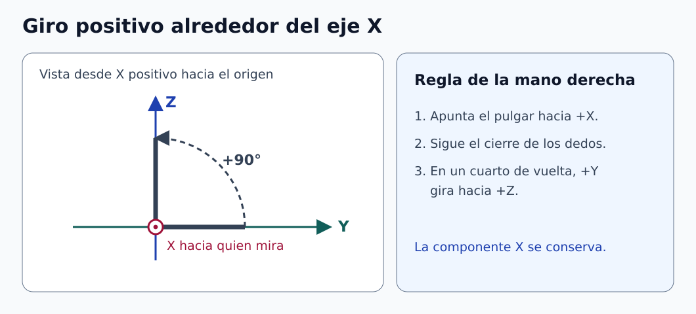

# Clase 01 · Fundamentos de robótica industrial y cinemática

**Asignatura:** Robótica Industrial  
**Docente:** David Cortez Saravia  
**Fecha:** 29 de octubre de 2026

La primera sesión presentó los componentes y las configuraciones de un robot industrial. A partir de esos elementos, introdujimos los sistemas de referencia, la regla de la mano derecha y la diferencia entre calcular la pose de una herramienta y buscar los movimientos articulares que permiten alcanzarla.

## Grabación de la clase

[Ingresar a AVAC con la cuenta institucional](https://avac.ups.edu.ec/). Abre el aula de la asignatura y busca la grabación por la fecha de la sesión, si está habilitada.

## De los antecedentes al manipulador industrial

La obra *R.U.R.* de Karel Čapek y las leyes de la robótica de Isaac Asimov sirvieron como puntos de partida para discutir la relación entre personas y máquinas. Las leyes de Asimov pertenecen a la ficción. Para estudiar un robot industrial, la discusión pasa a cuestiones concretas de diseño, control y uso. También se comentó la evolución de la electrónica. La observación de Moore trata sobre el crecimiento de la cantidad de componentes integrados en un circuito, no sobre el tamaño físico del chip. [1]

En el contexto industrial, un manipulador reprogramable puede ejecutar distintas operaciones mediante cambios de programa y, según la aplicación, de herramienta. Para estudiarlo como sistema, separamos tres elementos:

| Elemento | Función | Ejemplo |
| --- | --- | --- |
| Estructura mecánica | Sostener y guiar el movimiento mediante eslabones y articulaciones | Brazo, muñeca y base |
| Herramienta de extremo de brazo (EOAT) | Ejecutar la operación sobre la pieza o el entorno | Pinza, ventosa o antorcha |
| Sistema de control | Coordinar el movimiento y procesar las señales de sensores | Controlador, accionamientos y realimentación de posición |

Una articulación **revoluta** permite un giro y una **prismática** permite un desplazamiento lineal. Una articulación cilíndrica ideal permite giro y desplazamiento independientes sobre el mismo eje. Una cadena abierta conecta la base con la herramienta mediante una secuencia de articulaciones. Una cadena cerrada contiene al menos un lazo y sus restricciones afectan la movilidad.

## Configuración, grados de libertad y espacio de trabajo

| Configuración | Disposición típica | Qué conviene observar |
| --- | --- | --- |
| Cartesiana | Tres articulaciones prismáticas | Desplazamientos alineados con ejes fijos |
| Cilíndrica | Una revoluta y dos prismáticas | Giro alrededor de la base y desplazamientos radial y axial |
| Esférica o polar | Dos revolutas y una prismática | Orientación del brazo y extensión radial |
| Articulada | Cadena con varias revolutas | Capacidad para orientar la herramienta y rodear obstáculos |
| SCARA | Dos revolutas paralelas para el movimiento plano, con eje vertical en configuraciones habituales | Alcance en el plano y desplazamiento vertical |

El espacio de trabajo real depende de las longitudes, los límites articulares, la herramienta y las interferencias. Por eso, la forma general de una arquitectura sirve para orientarse, pero no permite determinar el alcance de un modelo concreto.

Una pose de un cuerpo rígido libre en el espacio tiene **seis grados de libertad**: tres de posición y tres de orientación. Un robot puede tener más coordenadas articulares. La redundancia se define respecto a la tarea: un brazo de siete articulaciones suele tener redundancia local para una tarea de pose completa cuando su jacobiano tiene rango seis. Si la tarea solo fija la posición, también puede haber redundancia con menos articulaciones. [2]

Se discutieron actuadores eléctricos, neumáticos e hidráulicos y transmisiones por bandas, engranajes, cadenas o cables. La elección depende del par, la velocidad, la rigidez, el mantenimiento y la holgura admisible. Una banda y un engranaje pueden introducir errores por mecanismos diferentes. Para compararlos hay que especificar la aplicación y las condiciones de operación.

## Resolución, exactitud y repetibilidad

| Concepto | Pregunta para el ensayo |
| --- | --- |
| Resolución | ¿Cuál es el menor incremento que puede comandar o distinguir el sistema? Indiquen si se trata del sensor, del mando o del movimiento de la herramienta. |
| Exactitud de posicionamiento | ¿Qué tan cerca queda la posición media de la posición programada? |
| Repetibilidad de posicionamiento | ¿Cuánto se dispersan las posiciones alcanzadas al repetir la misma orden en condiciones comparables? |

Un robot puede llegar muchas veces casi al mismo punto y conservar un desplazamiento sistemático respecto a la posición programada. Para identificar ese caso hacen falta un punto de referencia y varias mediciones. Esta distinción se retomará en el proyecto del brazo gemelo.

## Regla de la mano derecha y rotación sobre X

Usamos marcos cartesianos de mano derecha. Para decidir el giro positivo, apunten el pulgar derecho en el sentido positivo del eje. El cierre de los dedos indica el sentido de giro. En una **rotación activa**, el marco permanece fijo y el vector gira. Con vectores columna, la rotación activa alrededor de $`X`$ es: [2]

```math
R_x(\theta)=
\begin{bmatrix}
1&0&0\\[0pt]
0&\cos\theta&-\sin\theta\\[0pt]
0&\sin\theta&\cos\theta
\end{bmatrix},
\qquad \mathbf p'=R_x(\theta)\mathbf p.
```



*Figura 1. Regla de la mano derecha para la rotación sobre X. [Descripción en texto](figuras/DESCRIPCIONES.md) · [Créditos](figuras/CREDITOS.md).*

**Ejemplo complementario.** Si $`\mathbf p=(2,1,0)^\mathsf{T}`$ y $`\theta=90^\circ`$, el resultado es $`\mathbf p'=(2,0,1)^\mathsf{T}`$. La componente X se conserva y la dirección positiva de Y gira hacia Z. Si se busca expresar el mismo vector en un marco que giró en sentido positivo, se utiliza la rotación inversa $`R_x^\mathsf{T}`$.

## Cinemática directa e inversa

La **cinemática directa** obtiene la pose de la herramienta a partir de la configuración articular. La **inversa** busca configuraciones que alcancen una pose deseada. Puede haber varias soluciones, una sola o ninguna, según el objetivo y las restricciones. Calcular una pose alcanzable es un paso distinto de generar una trayectoria que respete límites y evite obstáculos. [2]

**Ejemplo complementario.** En un brazo plano con dos articulaciones revolutas, $`q_1`$ se mide desde el eje horizontal y $`q_2`$ es el giro del segundo eslabón respecto al primero. Para longitudes $`L_1`$ y $`L_2`$, la posición del extremo es:

```math
x=L_1\cos q_1+L_2\cos(q_1+q_2),
\qquad
y=L_1\sin q_1+L_2\sin(q_1+q_2).
```

Con longitudes de 0,30 m y 0,20 m y ángulos de 30° y 60°, respectivamente, el extremo queda en **(0,260 m, 0,350 m)**, redondeado al milímetro. El segundo eslabón queda vertical porque su orientación absoluta es 90°. Para un objetivo de posición a más de 0,50 m de la base no hay solución en este modelo ideal.

## Proyecto de curso · Brazo robótico gemelo

La propuesta inicial consiste en construir un conjunto **maestro–esclavo con al menos cuatro grados de libertad**. El maestro mide los movimientos articulares con potenciómetros. El esclavo utiliza motores para reproducir las consignas. Al diseñar la prueba, conviene distinguir entre el ángulo enviado y el ángulo realmente alcanzado. Un registro de la consigna por sí solo no permite medir el error de seguimiento.

Como punto de partida, documenten la correspondencia entre articulaciones, la calibración de los sensores y una prueba que permita estimar el error y la dispersión al repetir un movimiento. La rúbrica, los grupos y las condiciones de entrega se consultan en AVAC.

## Para practicar

1. Dibujen un sistema cartesiano de mano derecha e indiquen el sentido positivo de giro sobre X.
2. Calculen la rotación de $`(0,1,0)^\mathsf{T}`$ para 90° y −90°. Comprueben los signos con el esquema.
3. En el brazo plano del ejemplo, mantengan las longitudes y prueben con ángulos de 0° y 90°. Dibujen la configuración y comparen el resultado con la ecuación.
4. Propongan una medición que distinga un error sistemático de una dispersión entre repeticiones en el brazo gemelo.

## Referencias de apoyo

1. Intel. [Moore’s Law](https://www.intel.com/content/www/us/en/history/virtual-vault/articles/moores-law.html). Contexto de la observación original.
2. K. M. Lynch y F. C. Park. [Modern Robotics](https://modernrobotics.northwestern.edu/nu-gm-book-resource/). Consulten los capítulos sobre espacio de configuraciones, rotaciones, cinemática directa, cinemática de velocidades y cinemática inversa. [Rotaciones y representación de orientaciones](https://modernrobotics.northwestern.edu/nu-gm-book-resource/3-2-1-rotation-matrices-part-1-of-2/).

3. P. Corke. [Robotics Toolbox for MATLAB](https://github.com/petercorke/robotics-toolbox-matlab). Repositorio del autor con instrucciones y funciones para modelar y analizar manipuladores.

---

[Volver a Robótica Industrial](../../README.md) · [Volver al portafolio](../../../../README.md)
