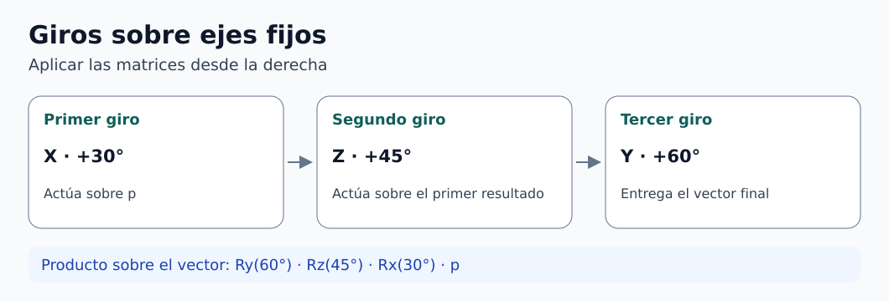

# Clase 02 · Matrices y composición de rotaciones

**Asignatura:** Robótica Industrial  
**Docente:** David Cortez Saravia  
**Fecha:** 5 de noviembre de 2026

[Clase anterior · Fundamentos de robótica industrial y cinemática](../clase-01-fundamentos-cinematica/README.md)

En esta sesión pasamos de un giro alrededor de X a una secuencia de giros alrededor de tres ejes. El resultado depende de dos decisiones: en qué orden se ejecutan los giros y respecto a qué marco se define cada eje.

## Matrices elementales

Usaremos vectores columna, rotaciones activas y ejes de mano derecha. Los ángulos $`\alpha,\beta,\theta `$ corresponden a giros alrededor de X, Y y Z, respectivamente. Cada matriz conserva la componente del vector sobre su eje. [1]

```math
R_x(\alpha)=
\begin{bmatrix}
1&0&0\\[0pt]
0&\cos\alpha&-\sin\alpha\\[0pt]
0&\sin\alpha&\cos\alpha
\end{bmatrix}
```

```math
R_y(\beta)=
\begin{bmatrix}
\cos\beta&0&\sin\beta\\[0pt]
0&1&0\\[0pt]
-\sin\beta&0&\cos\beta
\end{bmatrix}
```

```math
R_z(\theta)=
\begin{bmatrix}
\cos\theta&-\sin\theta&0\\[0pt]
\sin\theta&\cos\theta&0\\[0pt]
0&0&1
\end{bmatrix}
```

Para comprobar los signos, prueben un giro de +90°. Al girar sobre X, +Y pasa a +Z. Sobre Y, +Z pasa a +X. Sobre Z, +X pasa a +Y. Cada columna de la matriz muestra a dónde va el vector unitario correspondiente.

## Giros sobre ejes fijos y móviles

Supongan que $`R `$ describe la orientación del marco móvil respecto al fijo y que $`Q `$ es la matriz del siguiente giro. La actualización depende de dónde se expresa ese giro. [1]

| Eje del nuevo giro | Actualización | Qué se mantiene como referencia |
| --- | --- | --- |
| Eje del marco fijo | $`R_{\mathrm{nuevo}}=QR `$ | El eje inicial en el espacio |
| Eje del marco móvil | $`R_{\mathrm{nuevo}}=RQ `$ | El eje que acompaña al cuerpo |

Si los giros activos se aplican sucesivamente a un vector sobre **ejes fijos**, la primera matriz queda junto al vector, en el extremo derecho. En cambio, para actualizar una orientación con giros definidos en ejes del cuerpo se multiplica por la derecha en cada paso. Conviene escribir la secuencia física antes de multiplicar.

## Ejercicio de clase · X 30°, Z 45°, Y 60°

Los tres giros se expresan respecto al **marco fijo**. Se parte de $`\mathbf p=(2,1,1)^\mathsf{T} `$. El producto actúa sobre el vector de derecha a izquierda:

```math
\mathbf p'=R_y(60^\circ)R_z(45^\circ)R_x(30^\circ)\mathbf p.
```



*Figura 1. Secuencia física y orden del producto. [Descripción en texto](figuras/DESCRIPCIONES.md) · [Créditos](figuras/CREDITOS.md).*

El producto numérico y el vector resultante son, con redondeo al final:

```math
R\approx
\begin{bmatrix}
0.35355&0.12683&0.92678\\[0pt]
0.70711&0.61237&-0.35355\\[0pt]
-0.61237&0.78033&0.12683
\end{bmatrix},
\qquad
\mathbf p'\approx
\begin{bmatrix}
1.76071\\[0pt]
1.67303\\[0pt]
-0.31759
\end{bmatrix}.
```

El producto de dos matrices de 3 × 3 entrega otra matriz de 3 × 3. Multiplicarla por el vector de 3 × 1 produce una nueva columna de 3 × 1. Para obtener cada entrada se combina una fila con una columna. El determinante sirve como comprobación, no como paso para calcular las entradas.

Una matriz de rotación cumple $`R^\mathsf{T}R=I `$ y $`\det R=1 `$. En este ejercicio, tanto el vector inicial como el final tienen norma $`\sqrt 6 `$ antes de redondear. Con la convención activa y el marco fijo, la componente Z pasa a ser negativa.

## Aplicación a la cinemática

En cinemática directa, la orientación de la herramienta se obtiene encadenando orientaciones entre marcos. En cinemática inversa, se busca una configuración articular que alcance la pose pedida, si es posible. Las rotaciones de esta sesión describen cambios de orientación alrededor de un origen común. Para incorporar el desplazamiento de los orígenes entre eslabones se utilizarán transformaciones homogéneas.

En el proyecto del brazo gemelo, documenten desde qué marco se mide cada ángulo y cómo se define el giro positivo. Esas convenciones serán necesarias para comparar la orden del maestro con el movimiento del esclavo. Los criterios de entrega se consultan en AVAC.

## Para practicar

Reconstruyan el cálculo del ejercicio aplicando las matrices una a una. Después mantengan los ángulos y cambien el orden físico a Y, Z y X, siempre sobre ejes fijos. Comparen las coordenadas obtenidas y verifiquen la norma de ambos resultados.

## Referencia

1. K. M. Lynch y F. C. Park. [Modern Robotics · Rotation Matrices, Part 2](https://modernrobotics.northwestern.edu/nu-gm-book-resource/3-2-1-rotation-matrices-part-2-of-2/). Interpretación de la multiplicación por la izquierda y por la derecha, y cambio de marco.

[Volver a Robótica Industrial](../../README.md) · [Volver al portafolio](../../../../README.md)
